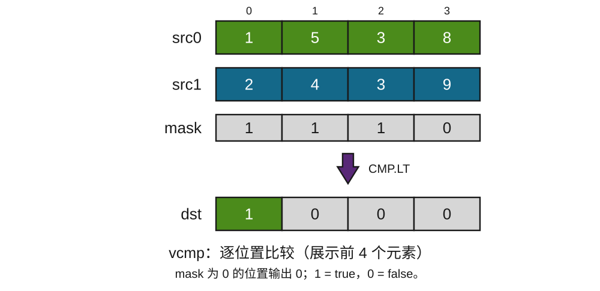
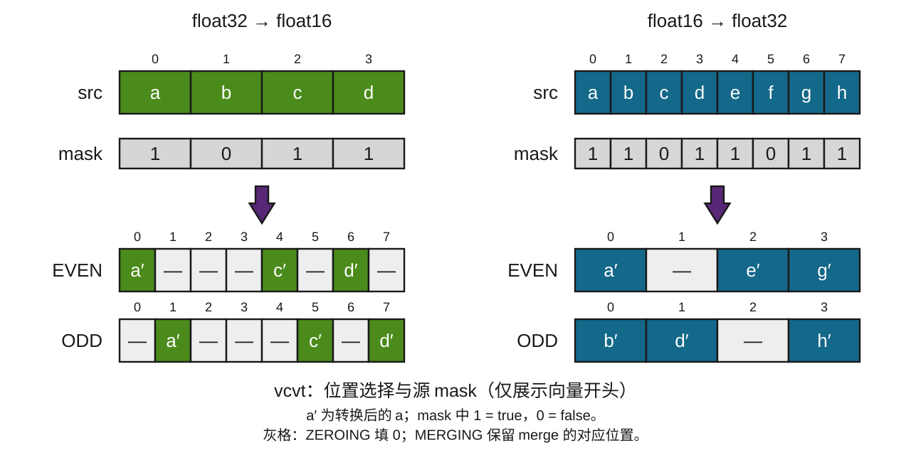
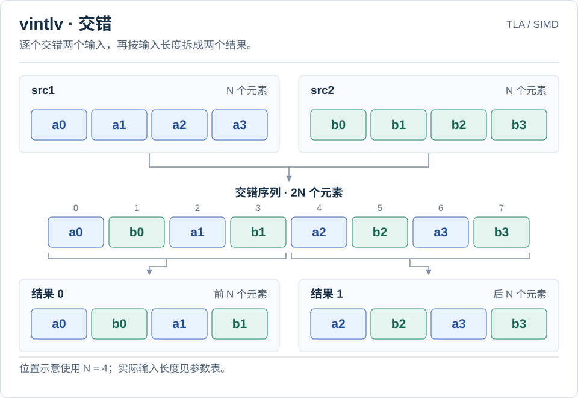
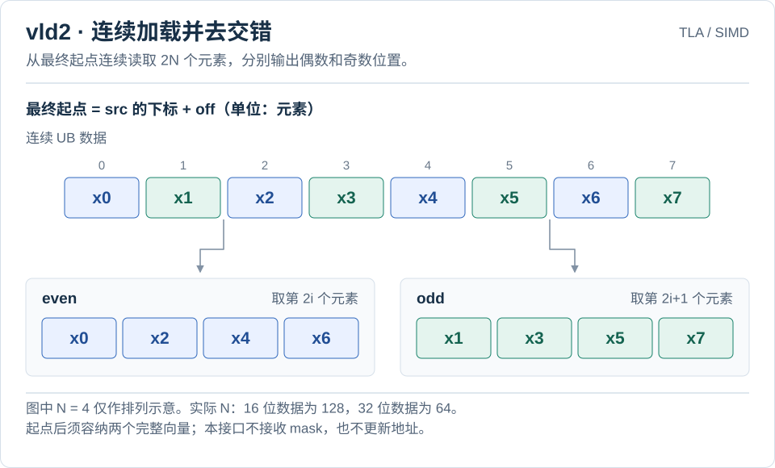
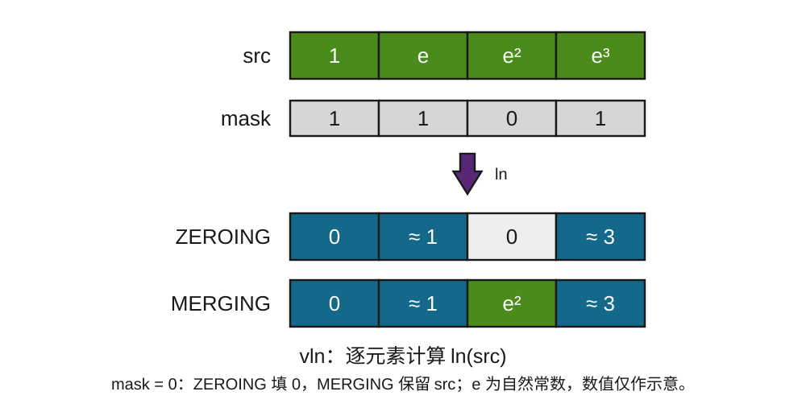
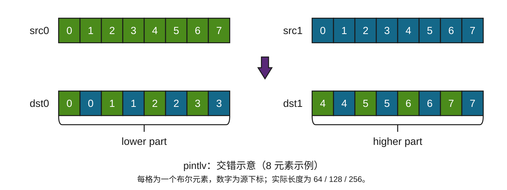
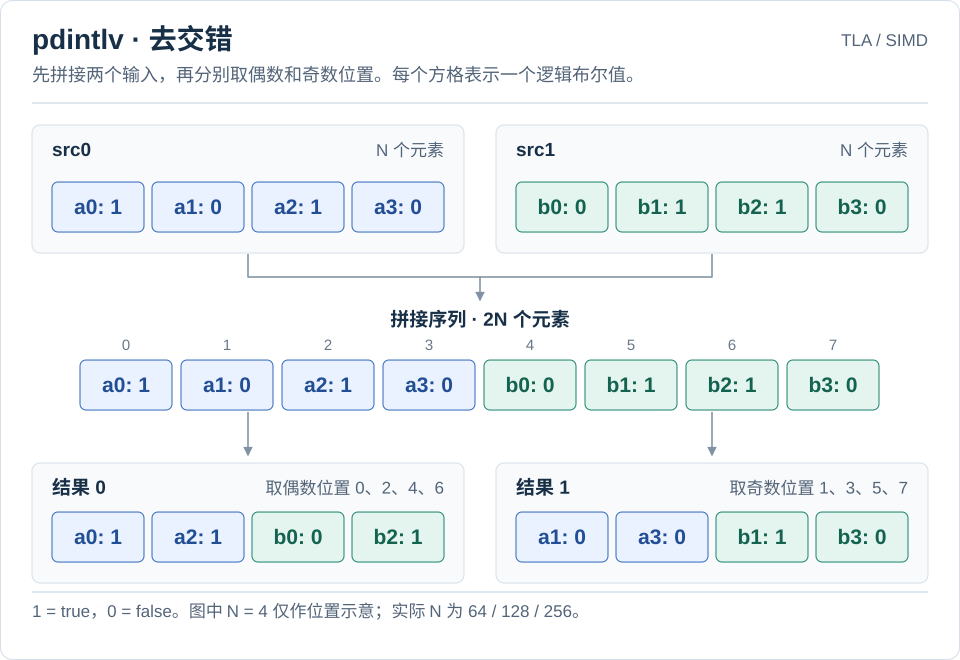

# SIMD接口规格

[返回接口目录](../README.md)

<a name="api-tla-scope-vector"></a>

## tla.scope.vector

签名：`tla.scope.vector()`

返回：无独立返回值。通过 with 声明内核区域。

将区域标记为 Vector 核模式，可在其内部声明 SIMD 区域。

**调用示例**

```python
@tla.jit
def example(x, dst_ub):
    with tla.scope.vector():
        tla.load_gm_to_ub(tla.view(x, (64,)), dst_ub)
```

仓库测试：[tla_ut/scope/pointer_abi.py](https://github.com/triton-lang/triton-ascend/blob/074cf62907f815694a01e5cdc4ac78a90610ae82/third_party/ascend/unittest/tla_ut/scope/pointer_abi.py#L14)。

<a name="api-tla-scope-simd"></a>

## tla.scope.simd

签名：`tla.scope.simd()`

返回：无独立返回值。通过 with 声明内核区域。

将区域标记为 AIV SIMD 向量函数，供后端提取为独立的向量函数。

**调用示例**

两个 UB 缓冲区均为连续 64 个 float32 元素。

```python
@tla.jit
def example(x_ub, y_ub):
    with tla.scope.simd():
        tile = tla.simd.vlds(x_ub[0])
        tla.simd.vsts(y_ub[0], tile, dist=tla.simd.STORE_DIST.NORM_B32)
```

仓库测试：[tla_ut/scope/simd_only.py](https://github.com/triton-lang/triton-ascend/blob/074cf62907f815694a01e5cdc4ac78a90610ae82/third_party/ascend/unittest/tla_ut/scope/simd_only.py#L25)。

<a name="api-tla-simd-membar"></a>

## tla.simd.membar

签名：`tla.simd.membar(scope)`

返回：None。

编译表示：ave.hir.membar。

| 参数名 | 参数含义 | 参数类型 | 合法参数范围 | 其他约束 | 默认值 |
| --- | --- | --- | --- | --- | --- |
| `scope` | 指定执行域或地址空间 | 编译期 tla.simd.SCOPE | SCOPE.VV_ALL / SCOPE.VST_VLD / SCOPE.VLD_VST / SCOPE.VST_VST / SCOPE.VS_ALL / SCOPE.VST_LD / SCOPE.VLD_ST / SCOPE.VST_ST / SCOPE.SV_ALL / SCOPE.ST_VLD / SCOPE.LD_VST / SCOPE.ST_VST / SCOPE.SS_ALL / SCOPE.ST_LD / SCOPE.LD_ST / SCOPE.ST_ST | SIMD VF 内的标量或向量 load/store 屏障，按访问顺序选择。不在上表的取值直接报错。 | 必填 |

**调用示例**

两个 UB 缓冲区均为 64 个 float32 元素。

```python
@tla.jit
def example(src_ub, dst_ub):
    with tla.scope.simd():
        values = tla.simd.vlds(src_ub[0])
        tla.simd.vsts(dst_ub[0], values, dist=tla.simd.STORE_DIST.NORM_B32)
        tla.simd.membar(tla.simd.SCOPE.VST_VLD)
        next_values = tla.simd.vlds(dst_ub[0])
```

仓库测试：[tla_ut/vector/norm_forward.py](https://github.com/triton-lang/triton-ascend/blob/074cf62907f815694a01e5cdc4ac78a90610ae82/third_party/ascend/unittest/tla_ut/vector/norm_forward.py#L49)。

<a name="api-tla-simd-pand"></a>

## tla.simd.pand

签名：`tla.simd.pand(src0, src1, mask=None)`

返回：谓词向量。

编译表示：ave.hir.preg。

| 参数名 | 参数含义 | 参数类型 | 合法参数范围 | 其他约束 | 默认值 |
| --- | --- | --- | --- | --- | --- |
| `src0` | 第一个源操作数 | tla.vector（int1 谓词） | 数据类型：<br>B1：int1 | 各谓词 lane 数相同。 | 必填 |
| `src1` | 第二个源操作数 | tla.vector（int1 谓词） | 数据类型：<br>B1：int1 | 各谓词 lane 数相同。 | 必填 |
| `mask` | 控制各 lane 是否启用的谓词 | tla.vector（int1 谓词） 或 None | 数据类型：<br>B1：int1<br>lane 数：与相应向量一致 | None 生成全真 mask。 | None |

输入 dtype 或 lane 数不一致时抛 ValueError；同型但非 int1 的输入抛 TypeError。mask 必须为同 lane 数的 int1 谓词，不进行类型转换或广播。

**调用示例**

```python
@tla.jit
def example():
    with tla.scope.simd():
        a = tla.simd.pge(32, 64)
        b = tla.simd.pge(16, 64)
        mask = tla.simd.pand(a, b)
```

仓库测试：[tla_ut/simd/pand.py](https://github.com/triton-lang/triton-ascend/blob/074cf62907f815694a01e5cdc4ac78a90610ae82/third_party/ascend/unittest/tla_ut/simd/pand.py#L43)。

<a name="api-tla-simd-pnot"></a>

## tla.simd.pnot

签名：`tla.simd.pnot(src, mask=None)`

返回：谓词向量。

编译表示：ave.hir.preg。

| 参数名 | 参数含义 | 参数类型 | 合法参数范围 | 其他约束 | 默认值 |
| --- | --- | --- | --- | --- | --- |
| `src` | 源数据 | tla.vector（int1 谓词） | 数据类型：<br>B1：int1 | 各谓词 lane 数相同。 | 必填 |
| `mask` | 控制各 lane 是否启用的谓词 | tla.vector（int1 谓词） 或 None | 数据类型：<br>B1：int1<br>lane 数：与相应向量一致 | None 生成全真 mask。 | None |

**调用示例**

```python
@tla.jit
def example():
    with tla.scope.simd():
        a = tla.simd.pge(32, 64)
        mask = tla.simd.pnot(a)
```

仓库测试：[tla_ut/simd/pnot.py](https://github.com/triton-lang/triton-ascend/blob/074cf62907f815694a01e5cdc4ac78a90610ae82/third_party/ascend/unittest/tla_ut/simd/pnot.py#L34)。

<a name="api-tla-simd-pset"></a>

## tla.simd.pset

签名：`tla.simd.pset(elem_width, dist=tla.simd.PAT.ALL)`

返回：谓词向量。

编译表示：ave.hir.pge。

| 参数名 | 参数含义 | 参数类型 | 合法参数范围 | 其他约束 | 默认值 |
| --- | --- | --- | --- | --- | --- |
| `elem_width` | 数据元素位宽 | 编译期 int | 8 / 16 / 32 / 64 | 输出 int1 谓词。elem_width 为 8、16、32、64 时，分别输出 256、128、64、32 个元素。 | 必填 |
| `dist` | 谓词生成图样 | 编译期 tla.simd.PAT 枚举 | PAT.ALL / PAT.VL1 / PAT.VL2 / PAT.VL3 / PAT.VL4 / PAT.VL8 / PAT.VL16 / PAT.VL32 / PAT.VL64 / PAT.VL128 / PAT.M3 / PAT.M4 / PAT.H / PAT.Q / PAT.ALLF | 仅接受 PAT 枚举成员；图样须与谓词宽度匹配。 | PAT.ALL |

`PAT.ALL` 全部为 true；`PAT.ALLF` 全部为 false；`PAT.VL1`～`PAT.VL128` 中，数字表示置 true 的前缀长度，不得超过谓词长度。`PAT.H`、`PAT.Q` 分别将前一半、前四分之一置 true，其余为 false。

`pset(64)` 只有 32 个谓词元素，不能直接作为 64 元素数据向量的 mask。需要 64 个全真谓词时使用 `pge(64, 64)`。

**调用示例**

```python
@tla.jit
def example():
    with tla.scope.simd():
        mask = tla.simd.pset(32, dist=tla.simd.PAT.ALL)
```

仓库测试：[tla_ut/simd/pat_mask.py](https://github.com/triton-lang/triton-ascend/blob/074cf62907f815694a01e5cdc4ac78a90610ae82/third_party/ascend/unittest/tla_ut/simd/pat_mask.py#L46)。

<a name="api-tla-simd-pxor"></a>

## tla.simd.pxor

签名：`tla.simd.pxor(src0, src1, mask=None)`

返回：谓词向量。

编译表示：ave.hir.preg。

| 参数名 | 参数含义 | 参数类型 | 合法参数范围 | 其他约束 | 默认值 |
| --- | --- | --- | --- | --- | --- |
| `src0` | 第一个源操作数 | tla.vector（int1 谓词） | 数据类型：<br>B1：int1 | 各谓词 lane 数相同。 | 必填 |
| `src1` | 第二个源操作数 | tla.vector（int1 谓词） | 数据类型：<br>B1：int1 | 各谓词 lane 数相同。 | 必填 |
| `mask` | 控制各 lane 是否启用的谓词 | tla.vector（int1 谓词） 或 None | 数据类型：<br>B1：int1<br>lane 数：与相应向量一致 | None 生成全真 mask。 | None |

输入 dtype 或 lane 数不一致时抛 ValueError；同型但非 int1 的输入抛 TypeError。mask 必须为同 lane 数的 int1 谓词，不进行类型转换或广播。

**调用示例**

```python
@tla.jit
def example():
    with tla.scope.simd():
        a = tla.simd.pge(32, 64)
        b = tla.simd.pge(16, 64)
        mask = tla.simd.pxor(a, b)
```

仓库测试：[tla_ut/simd/pxor.py](https://github.com/triton-lang/triton-ascend/blob/074cf62907f815694a01e5cdc4ac78a90610ae82/third_party/ascend/unittest/tla_ut/simd/pxor.py#L43)。

<a name="api-tla-simd-vabs"></a>

## tla.simd.vabs

签名：`tla.simd.vabs(src, mask=None, mode=tla.simd.MODE.ZEROING)`

返回：tla.vector。

编译表示：ave.hir.vabs。

| 参数名 | 参数含义 | 参数类型 | 合法参数范围 | 其他约束 | 默认值 |
| --- | --- | --- | --- | --- | --- |
| `src` | 源数据 | tla.vector | 数据类型：<br>B8：int8<br>B16：int16 / float16<br>B32：int32 / float32<br>B64：int64 | 无符号整数输入被拒绝。每个向量最多包含：B8 256 个元素、B16 128 个元素、B32 64 个元素、B64 64 个元素。 | 必填 |
| `mask` | 控制各 lane 是否启用的谓词 | tla.vector（int1 谓词） 或 None | 数据类型：<br>B1：int1<br>lane 数：与相应向量一致 | None 生成全真 mask。 | None |
| `mode` | 未写入位置的处理方式 | 编译期 tla.simd.MODE 枚举 | MODE.ZEROING / MODE.MERGING | ZEROING：未写入位置填 0；MERGING：保留 `src` 对应位置的值。 | MODE.ZEROING |

**调用示例**

输入为各含 64 个 float32 元素的连续 UB 缓冲区。

```python
@tla.jit
def example(a_ub):
    with tla.scope.simd():
        a = tla.simd.vlds(a_ub[0])
        result = tla.simd.vabs(a)
```

仓库测试：[tla_ut/simd/vabs.py](https://github.com/triton-lang/triton-ascend/blob/074cf62907f815694a01e5cdc4ac78a90610ae82/third_party/ascend/unittest/tla_ut/simd/vabs.py#L46)。

<a name="api-tla-simd-vadd"></a>

## tla.simd.vadd

签名：`tla.simd.vadd(src0, src1, mask=None, mode=tla.simd.MODE.ZEROING)`

返回：tla.vector。

编译表示：ave.hir.vadd。

| 参数名 | 参数含义 | 参数类型 | 合法参数范围 | 其他约束 | 默认值 |
| --- | --- | --- | --- | --- | --- |
| `src0` | 第一个源操作数 | tla.vector | 数据类型：<br>B8：int8 / uint8<br>B16：int16 / uint16 / float16 / bfloat16<br>B32：int32 / uint32 / float32<br>B64：int64 / uint64 | 两操作数必须同 dtype、同 lane 数，不一致直接报错，不做隐式转换或广播；每个向量最多包含：B8 256 个元素、B16 128 个元素、B32 64 个元素、B64 64 个元素。 | 必填 |
| `src1` | 第二个源操作数 | tla.vector | 数据类型：<br>B8：int8 / uint8<br>B16：int16 / uint16 / float16 / bfloat16<br>B32：int32 / uint32 / float32<br>B64：int64 / uint64 | 两操作数必须同 dtype、同 lane 数，不一致直接报错，不做隐式转换或广播；每个向量最多包含：B8 256 个元素、B16 128 个元素、B32 64 个元素、B64 64 个元素。 | 必填 |
| `mask` | 控制各 lane 是否启用的谓词 | tla.vector（int1 谓词） 或 None | 数据类型：<br>B1：int1<br>lane 数：与相应向量一致 | None 生成全真 mask。 | None |
| `mode` | 未写入位置的处理方式 | 编译期 tla.simd.MODE 枚举 | MODE.ZEROING / MODE.MERGING | ZEROING：未写入位置填 0；MERGING：保留 `src0` 对应位置的值。 | MODE.ZEROING |

**调用示例**

输入为各含 64 个 float32 元素的连续 UB 缓冲区。

```python
@tla.jit
def example(a_ub, b_ub):
    with tla.scope.simd():
        a = tla.simd.vlds(a_ub[0])
        b = tla.simd.vlds(b_ub[0])
        result = tla.simd.vadd(a, b)
```

仓库测试：[tla_ut/scope/simd_only.py](https://github.com/triton-lang/triton-ascend/blob/074cf62907f815694a01e5cdc4ac78a90610ae82/third_party/ascend/unittest/tla_ut/scope/simd_only.py#L27)。

<a name="api-tla-simd-vaddc"></a>

## tla.simd.vaddc

签名：`tla.simd.vaddc(src0, src1, mask=None)`

返回：结果向量与进位谓词。

编译表示：ave.hir.vadd / ave.hir.vcmp。

| 参数名 | 参数含义 | 参数类型 | 合法参数范围 | 其他约束 | 默认值 |
| --- | --- | --- | --- | --- | --- |
| `src0` | 第一个源操作数 | tla.vector | 数据类型：<br>B32：int32 / uint32 | 两个输入须同 dtype、同元素个数；不一致时报错。每个向量最多包含 64 个元素。 | 必填 |
| `src1` | 第二个源操作数 | tla.vector | 数据类型：<br>B32：int32 / uint32 | 两个输入须同 dtype、同元素个数；不一致时报错。每个向量最多包含 64 个元素。 | 必填 |
| `mask` | 控制各 lane 是否启用的谓词 | tla.vector（int1 谓词） 或 None | 数据类型：<br>B1：int1<br>lane 数：与相应向量一致 | None 生成全真 mask。 | None |

和按 2³² 取模；按无符号数相加超过 2³²−1 时，进位为 true。mask 为 false 的位置返回 0 和 false。

**调用示例**

输入为各含 64 个 int32 元素的连续 UB 缓冲区。

```python
@tla.jit
def example(a_ub, b_ub):
    with tla.scope.simd():
        a = tla.simd.vlds(a_ub[0])
        b = tla.simd.vlds(b_ub[0])
        result, carry = tla.simd.vaddc(a, b)
```

仓库测试：[tla_ut/simd/add_cmp.py](https://github.com/triton-lang/triton-ascend/blob/074cf62907f815694a01e5cdc4ac78a90610ae82/third_party/ascend/unittest/tla_ut/simd/add_cmp.py#L117)。

<a name="api-tla-simd-vadds"></a>

## tla.simd.vadds

签名：`tla.simd.vadds(src, scalar, mask=None, mode=tla.simd.MODE.ZEROING)`

返回：tla.vector。

编译表示：ave.hir.vadds。

| 参数名 | 参数含义 | 参数类型 | 合法参数范围 | 其他约束 | 默认值 |
| --- | --- | --- | --- | --- | --- |
| `src` | 源数据 | tla.vector | 数据类型：<br>B8：int8 / uint8<br>B16：int16 / uint16 / float16<br>B32：int32 / uint32 / float32<br>B64：int64 / uint64 | 参与计算的向量需同 dtype、同 lane 数。 B64 向量最多包含 64 个元素。 | 必填 |
| `scalar` | 广播给各 lane 的标量操作数 | int / float / 标量 tl.tensor | 数据类型：<br>B8：int8 / uint8<br>B16：int16 / uint16 / float16<br>B32：int32 / uint32 / float32<br>B64：int64 / uint64 | 标量 tensor 与源 dtype 一致。整数常量使用源 dtype 的数值范围。单 lane vector 不能作为标量输入。 B64 大整数常量可能丢失精度；需保持精确值时传入同 dtype 的标量 tensor。整数必须落在 src 元素类型的取值范围内，类型不可转换或超出范围直接报错。 | 必填 |
| `mask` | 控制各 lane 是否启用的谓词 | tla.vector（int1 谓词） 或 None | 数据类型：<br>B1：int1<br>lane 数：与相应向量一致 | None 生成全真 mask。 | None |
| `mode` | 未写入位置的处理方式 | 编译期 tla.simd.MODE 枚举 | MODE.ZEROING / MODE.MERGING | ZEROING：未写入位置填 0；MERGING：保留 `src` 对应位置的值。 | MODE.ZEROING |

**调用示例**

输入为各含 64 个 float32 元素的连续 UB 缓冲区。

```python
@tla.jit
def example(a_ub):
    with tla.scope.simd():
        a = tla.simd.vlds(a_ub[0])
        result = tla.simd.vadds(a, 2.0)
```

仓库测试：[tla_ut/simd/add_cmp.py](https://github.com/triton-lang/triton-ascend/blob/074cf62907f815694a01e5cdc4ac78a90610ae82/third_party/ascend/unittest/tla_ut/simd/add_cmp.py#L102)。

<a name="api-tla-simd-vand"></a>

## tla.simd.vand

签名：`tla.simd.vand(src0, src1, mask=None, mode=tla.simd.MODE.ZEROING)`

返回：tla.vector。

编译表示：ave.hir.vand / ave.hir.vsel。

| 参数名 | 参数含义 | 参数类型 | 合法参数范围 | 其他约束 | 默认值 |
| --- | --- | --- | --- | --- | --- |
| `src0` | 第一个源操作数 | tla.vector | 数据类型：<br>B8：int8 / uint8<br>B16：int16 / uint16 / float16 / bfloat16<br>B32：int32 / uint32 / float32<br>B64：int64 / uint64 | 参与计算的向量需同 dtype（含符号性）、同 lane 数；不一致抛 ValueError，不隐式转换或广播。 B64 向量最多包含 64 个元素。 | 必填 |
| `src1` | 第二个源操作数 | tla.vector | 数据类型：<br>B8：int8 / uint8<br>B16：int16 / uint16 / float16 / bfloat16<br>B32：int32 / uint32 / float32<br>B64：int64 / uint64 | 参与计算的向量需同 dtype（含符号性）、同 lane 数；不一致抛 ValueError，不隐式转换或广播。 B64 向量最多包含 64 个元素。 | 必填 |
| `mask` | 控制各 lane 是否启用的谓词 | tla.vector（int1 谓词） 或 None | 数据类型：<br>B1：int1<br>lane 数：与相应向量一致 | None 生成全真 mask。 | None |
| `mode` | 未写入位置的处理方式 | 编译期 tla.simd.MODE 枚举 | MODE.ZEROING / MODE.MERGING | ZEROING：未写入位置填 0；MERGING：保留 `src0` 对应位置的值。 | MODE.ZEROING |

**调用示例**

输入为各含 64 个 int32 元素的连续 UB 缓冲区。

```python
@tla.jit
def example(a_ub, b_ub):
    with tla.scope.simd():
        a = tla.simd.vlds(a_ub[0])
        b = tla.simd.vlds(b_ub[0])
        result = tla.simd.vand(a, b)
```

仓库测试：[tla_ut/simd/pat_mask.py](https://github.com/triton-lang/triton-ascend/blob/074cf62907f815694a01e5cdc4ac78a90610ae82/third_party/ascend/unittest/tla_ut/simd/pat_mask.py#L47)。

<a name="api-tla-simd-vaxpy"></a>

## tla.simd.vaxpy

签名：`tla.simd.vaxpy(acc, src, scalar, mask=None, mode=tla.simd.MODE.ZEROING)`

返回：tla.vector。

编译表示：ave.hir.vmuls / ave.hir.vadd / ave.hir.vsel。

| 参数名 | 参数含义 | 参数类型 | 合法参数范围 | 其他约束 | 默认值 |
| --- | --- | --- | --- | --- | --- |
| `acc` | 累加器 | tla.vector | 数据类型：<br>B8：int8 / uint8<br>B16：int16 / uint16 / float16<br>B32：int32 / uint32 / float32<br>B64：不支持 | 参与计算的向量需同 dtype（含符号性）、同 lane 数；不一致抛 ValueError，不隐式转换或广播。 | 必填 |
| `src` | 源数据 | tla.vector | 数据类型：<br>B8：int8 / uint8<br>B16：int16 / uint16 / float16<br>B32：int32 / uint32 / float32<br>B64：不支持 | 参与计算的向量需同 dtype（含符号性）、同 lane 数；不一致抛 ValueError，不隐式转换或广播。 | 必填 |
| `scalar` | 广播给各 lane 的标量操作数 | int / float / 标量 tl.tensor | 数据类型：<br>B8：int8 / uint8<br>B16：int16 / uint16 / float16<br>B32：int32 / uint32 / float32<br>B64：不支持 | tensor 须为秩 0 且与 src 同 dtype；类型不符抛 TypeError，秩不符抛 ValueError。整数向量只接受整数常量（不含 bool），越界抛 ValueError；不接受 vector。 | 必填 |
| `mask` | 控制各 lane 是否启用的谓词 | tla.vector（int1 谓词） 或 None | 数据类型：<br>B1：int1<br>lane 数：与相应向量一致 | None 生成全真 mask。 | None |
| `mode` | 未写入位置的处理方式 | 编译期 tla.simd.MODE 枚举 | MODE.ZEROING / MODE.MERGING | ZEROING：未写入位置填 0；MERGING：保留 `acc` 对应位置的值。 | MODE.ZEROING |

逐元素计算 `acc + src × scalar`，先乘后加；浮点运算不保证融合为一次舍入。

**调用示例**

输入为各含 64 个 float32 元素的连续 UB 缓冲区。

```python
@tla.jit
def example(a_ub, b_ub):
    with tla.scope.simd():
        a = tla.simd.vlds(a_ub[0])
        b = tla.simd.vlds(b_ub[0])
        result = tla.simd.vaxpy(a, b, 2.0)
```

仓库测试：[tla_ut/simd/vaxpy.py](https://github.com/triton-lang/triton-ascend/blob/074cf62907f815694a01e5cdc4ac78a90610ae82/third_party/ascend/unittest/tla_ut/simd/vaxpy.py#L38)。

<a name="api-tla-simd-vcadd"></a>

## tla.simd.vcadd

签名：`tla.simd.vcadd(src, mask=None, mode=tla.simd.MODE.ZEROING, *, merge=None)`

返回：与 src 同 dtype、同 lane 数的向量；第 0 个元素为求和结果，其余位置由 mode 决定。

编译表示：ave.hir.reduction。

| 参数名 | 参数含义 | 参数类型 | 合法参数范围 | 其他约束 | 默认值 |
| --- | --- | --- | --- | --- | --- |
| `src` | 待求和的数据 | tla.vector | 数据类型：<br>B32：int32 / float32<br>lane 数：64 | 本节仅确认 int32 / float32；其他类型的支持范围待确认。 | 必填 |
| `mask` | 选择参与计算的元素 | tla.vector（int1）或 None | 数据类型：<br>B1：int1<br>lane 数：64 | None 表示全部启用。 | None |
| `mode` | 未写入位置的处理方式 | 编译期 tla.simd.MODE 枚举 | MODE.ZEROING / MODE.MERGING | ZEROING：未写入位置填 0；MERGING：保留 `merge` 对应位置的值。第 0 个元素始终写入归约结果。 | MODE.ZEROING |
| `merge` | 未写入位置的保留值 | tla.vector 或 None | dtype、元素个数与返回向量相同 | MODE.MERGING 时必填；MODE.ZEROING 时须为 None。 | None |

对 mask 为真的所有源元素求和，结果放在第 0 个 lane。其余位置在 ZEROING 模式下填 0，在 MERGING 模式下保留 merge 的对应值。返回类型不扩宽；浮点结果遵循目标归约顺序，不保证与逐元素顺序累加逐位一致。

Ascend960 / A6 的设备支持范围待确认。

**调用示例**

x_ub 为连续 64 个 float32 元素；只使用 result 的第 0 个 lane。

```python
@tla.jit
def example(x_ub):
    with tla.scope.simd():
        src = tla.simd.vlds(x_ub[0])
        result = tla.simd.vcadd(src)
```

仓库测试：[memory_completion.py](https://github.com/triton-lang/triton-ascend/blob/d54604c1133df2631c6b32d8649eea79c6b2c975/third_party/ascend/unittest/tla_ut/simd/memory_completion.py#L48)。

<a name="api-tla-simd-vcgadd"></a>

## tla.simd.vcgadd

签名：`tla.simd.vcgadd(src, mask=None, mode=tla.simd.MODE.ZEROING, *, merge=None)`

返回：满寄存器向量，前 8 个元素为各组结果，其余位置由 mode 决定。

编译表示：ave.hir.group_reduction。

| 参数名 | 参数含义 | 参数类型 | 合法参数范围 | 其他约束 | 默认值 |
| --- | --- | --- | --- | --- | --- |
| `src` | 待分组归约的数据 | tla.vector | 数据类型：<br>B8：不支持<br>B16：int16 / uint16 / float16<br>B32：int32 / uint32 / float32<br>B64：不支持<br>lane 数：16 位为 128，32 位为 64 | 必须是完整 256 字节寄存器；不支持 int8 / uint8 / bfloat16 / int64 / uint64。 | 必填 |
| `mask` | 选择参与计算的元素 | tla.vector（int1）或 None | 数据类型：<br>B1：int1<br>lane 数：与 src 相同，16 位输入为 128，32 位为 64 | None 表示全部启用。 | None |
| `mode` | 未写入位置的处理方式 | 编译期 tla.simd.MODE 枚举 | MODE.ZEROING / MODE.MERGING | ZEROING：未写入位置填 0；MERGING：保留 `merge` 对应位置的值。前 8 个元素始终写入各组结果。 | MODE.ZEROING |
| `merge` | 未写入位置的保留值 | tla.vector 或 None | dtype、元素个数与返回向量相同 | MODE.MERGING 时必填；MODE.ZEROING 时须为 None。 | None |

仅支持 Ascend950；Ascend960 报不支持。把源寄存器分成 8 个连续的 32 字节组，每组独立求和：16 位数据每组 16 个元素，32 位数据每组 8 个元素。mask 控制源元素是否参与，不改变分组或结果位置。

int16 / uint16 输入扩宽为 int32 / uint32，返回 64 lanes；int32 / uint32 加法按 32 位回绕。float16 / float32 保持输入类型，按硬件顺序求和；空组结果为零。

**调用示例**

Ascend950；x_ub 为连续 64 个 float32 元素，result[0:8] 分别对应原数据的八组。

```python
@tla.jit
def example(x_ub):
    with tla.scope.simd():
        src = tla.simd.vlds(x_ub[0])
        result = tla.simd.vcgadd(src)
```

仓库测试：[group_reduce.py](https://github.com/triton-lang/triton-ascend/blob/d54604c1133df2631c6b32d8649eea79c6b2c975/third_party/ascend/unittest/tla_ut/simd/group_reduce.py#L33)。

<a name="api-tla-simd-vcgmax"></a>

## tla.simd.vcgmax

签名：`tla.simd.vcgmax(src, mask=None, mode=tla.simd.MODE.ZEROING, *, merge=None)`

返回：满寄存器向量，前 8 个元素为各组结果，其余位置由 mode 决定。

编译表示：ave.hir.group_reduction。

| 参数名 | 参数含义 | 参数类型 | 合法参数范围 | 其他约束 | 默认值 |
| --- | --- | --- | --- | --- | --- |
| `src` | 待分组归约的数据 | tla.vector | 数据类型：<br>B8：不支持<br>B16：int16 / uint16 / float16<br>B32：int32 / uint32 / float32<br>B64：不支持<br>lane 数：16 位为 128，32 位为 64 | 必须是完整 256 字节寄存器；不支持 int8 / uint8 / bfloat16 / int64 / uint64。 | 必填 |
| `mask` | 选择参与计算的元素 | tla.vector（int1）或 None | 数据类型：<br>B1：int1<br>lane 数：与 src 相同，16 位输入为 128，32 位为 64 | None 表示全部启用。 | None |
| `mode` | 未写入位置的处理方式 | 编译期 tla.simd.MODE 枚举 | MODE.ZEROING / MODE.MERGING | ZEROING：未写入位置填 0；MERGING：保留 `merge` 对应位置的值。前 8 个元素始终写入各组结果。 | MODE.ZEROING |
| `merge` | 未写入位置的保留值 | tla.vector 或 None | dtype、元素个数与返回向量相同 | MODE.MERGING 时必填；MODE.ZEROING 时须为 None。 | None |

仅支持 Ascend950；Ascend960 报不支持。把源寄存器分成 8 个连续的 32 字节组，每组独立取最大值：16 位数据每组 16 个元素，32 位数据每组 8 个元素。mask 控制源元素是否参与，不改变分组或结果位置。

结果保持输入 dtype 和 lane 数；整数比较按 dtype 的符号解释。空组使用硬件对应归约的初始值；浮点 NaN、正负零和无穷值遵循目标指令规则，不承诺与 Python 顺序比较一致。

**调用示例**

Ascend950；x_ub 为连续 64 个 float32 元素，result[0:8] 分别对应原数据的八组。

```python
@tla.jit
def example(x_ub):
    with tla.scope.simd():
        src = tla.simd.vlds(x_ub[0])
        result = tla.simd.vcgmax(src)
```

仓库测试：[group_reduce.py](https://github.com/triton-lang/triton-ascend/blob/d54604c1133df2631c6b32d8649eea79c6b2c975/third_party/ascend/unittest/tla_ut/simd/group_reduce.py#L33)。

<a name="api-tla-simd-vcgmin"></a>

## tla.simd.vcgmin

签名：`tla.simd.vcgmin(src, mask=None, mode=tla.simd.MODE.ZEROING, *, merge=None)`

返回：满寄存器向量，前 8 个元素为各组结果，其余位置由 mode 决定。

编译表示：ave.hir.group_reduction。

| 参数名 | 参数含义 | 参数类型 | 合法参数范围 | 其他约束 | 默认值 |
| --- | --- | --- | --- | --- | --- |
| `src` | 待分组归约的数据 | tla.vector | 数据类型：<br>B8：不支持<br>B16：int16 / uint16 / float16<br>B32：int32 / uint32 / float32<br>B64：不支持<br>lane 数：16 位为 128，32 位为 64 | 必须是完整 256 字节寄存器；不支持 int8 / uint8 / bfloat16 / int64 / uint64。 | 必填 |
| `mask` | 选择参与计算的元素 | tla.vector（int1）或 None | 数据类型：<br>B1：int1<br>lane 数：与 src 相同，16 位输入为 128，32 位为 64 | None 表示全部启用。 | None |
| `mode` | 未写入位置的处理方式 | 编译期 tla.simd.MODE 枚举 | MODE.ZEROING / MODE.MERGING | ZEROING：未写入位置填 0；MERGING：保留 `merge` 对应位置的值。前 8 个元素始终写入各组结果。 | MODE.ZEROING |
| `merge` | 未写入位置的保留值 | tla.vector 或 None | dtype、元素个数与返回向量相同 | MODE.MERGING 时必填；MODE.ZEROING 时须为 None。 | None |

仅支持 Ascend950；Ascend960 报不支持。把源寄存器分成 8 个连续的 32 字节组，每组独立取最小值：16 位数据每组 16 个元素，32 位数据每组 8 个元素。mask 控制源元素是否参与，不改变分组或结果位置。

结果保持输入 dtype 和 lane 数；整数比较按 dtype 的符号解释。空组使用硬件对应归约的初始值；浮点 NaN、正负零和无穷值遵循目标指令规则，不承诺与 Python 顺序比较一致。

**调用示例**

Ascend950；x_ub 为连续 64 个 float32 元素，result[0:8] 分别对应原数据的八组。

```python
@tla.jit
def example(x_ub):
    with tla.scope.simd():
        src = tla.simd.vlds(x_ub[0])
        result = tla.simd.vcgmin(src)
```

仓库测试：[group_reduce.py](https://github.com/triton-lang/triton-ascend/blob/d54604c1133df2631c6b32d8649eea79c6b2c975/third_party/ascend/unittest/tla_ut/simd/group_reduce.py#L33)。

<a name="api-tla-simd-vci"></a>

## tla.simd.vci

签名：`tla.simd.vci(base)`

返回：tla.vector。

编译表示：ave.hir.vci。

| 参数名 | 参数含义 | 参数类型 | 合法参数范围 | 其他约束 | 默认值 |
| --- | --- | --- | --- | --- | --- |
| `base` | 序列的起始值 | 编译期 int / 标量 int32 tl.tensor | −2³¹ 至 2³¹−1 | 结果固定为 64 lane int32 递增序列。 | 必填 |

`base` 的编译期值不是 int 或不在 int32 范围时抛 ValueError；运行时值不是秩 0 int32 时抛 TypeError。若需无溢出的递增索引，调用方还需保证 `base ≤ 2147483584`，使最后一项 `base + 63` 不超出 int32；前端未额外检查这一上界。

**调用示例**

```python
@tla.jit
def example():
    with tla.scope.simd():
        indices = tla.simd.vci(0)
```

仓库测试：[tla_ut/simd/pand.py](https://github.com/triton-lang/triton-ascend/blob/074cf62907f815694a01e5cdc4ac78a90610ae82/third_party/ascend/unittest/tla_ut/simd/pand.py#L38)。

<a name="api-tla-simd-vcmax"></a>

## tla.simd.vcmax

签名：`tla.simd.vcmax(src, mask=None, mode=tla.simd.MODE.ZEROING, *, merge=None)`

返回：tla.vector。

编译表示：ave.hir.reduction。

| 参数名 | 参数含义 | 参数类型 | 合法参数范围 | 其他约束 | 默认值 |
| --- | --- | --- | --- | --- | --- |
| `src` | 源数据 | tla.vector | 数据类型：<br>B8：int8 / uint8<br>B16：int16 / uint16 / float16 / bfloat16<br>B32：int32 / uint32 / float32<br>B64：不支持 | 规约结果放在 lane 0，其余 lane 不应当作规约结果使用。每个向量最多包含：B8 256 个元素、B16 128 个元素、B32 64 个元素。 | 必填 |
| `mask` | 控制各 lane 是否启用的谓词 | tla.vector（int1 谓词） 或 None | 数据类型：<br>B1：int1<br>lane 数：与相应向量一致 | None 生成全真 mask。 | None |
| `mode` | 未写入位置的处理方式 | 编译期 tla.simd.MODE 枚举 | MODE.ZEROING / MODE.MERGING | ZEROING：未写入位置填 0；MERGING：保留 `merge` 对应位置的值。第 0 个元素始终写入归约结果。 | MODE.ZEROING |
| `merge` | 未写入位置的保留值 | tla.vector 或 None | dtype、元素个数与返回向量相同 | MODE.MERGING 时必填；MODE.ZEROING 时须为 None。 | None |

**调用示例**

输入为各含 64 个 float32 元素的连续 UB 缓冲区。

```python
@tla.jit
def example(a_ub):
    with tla.scope.simd():
        a = tla.simd.vlds(a_ub[0])
        result = tla.simd.vcmax(a)
```

仓库测试：[tla_ut/simd/add_cmp.py](https://github.com/triton-lang/triton-ascend/blob/074cf62907f815694a01e5cdc4ac78a90610ae82/third_party/ascend/unittest/tla_ut/simd/add_cmp.py#L105)。

<a name="api-tla-simd-vcmin"></a>

## tla.simd.vcmin

签名：`tla.simd.vcmin(src, mask=None, mode=tla.simd.MODE.ZEROING, *, merge=None)`

返回：tla.vector。

编译表示：ave.hir.reduction。

| 参数名 | 参数含义 | 参数类型 | 合法参数范围 | 其他约束 | 默认值 |
| --- | --- | --- | --- | --- | --- |
| `src` | 源数据 | tla.vector | 数据类型：<br>B8：int8 / uint8<br>B16：int16 / uint16 / float16 / bfloat16<br>B32：int32 / uint32 / float32<br>B64：不支持 | 规约结果放在 lane 0，其余 lane 不应当作规约结果使用。每个向量最多包含：B8 256 个元素、B16 128 个元素、B32 64 个元素。 | 必填 |
| `mask` | 控制各 lane 是否启用的谓词 | tla.vector（int1 谓词） 或 None | 数据类型：<br>B1：int1<br>lane 数：与相应向量一致 | None 生成全真 mask。 | None |
| `mode` | 未写入位置的处理方式 | 编译期 tla.simd.MODE 枚举 | MODE.ZEROING / MODE.MERGING | ZEROING：未写入位置填 0；MERGING：保留 `merge` 对应位置的值。第 0 个元素始终写入归约结果。 | MODE.ZEROING |
| `merge` | 未写入位置的保留值 | tla.vector 或 None | dtype、元素个数与返回向量相同 | MODE.MERGING 时必填；MODE.ZEROING 时须为 None。 | None |

**调用示例**

输入为各含 64 个 float32 元素的连续 UB 缓冲区。

```python
@tla.jit
def example(a_ub):
    with tla.scope.simd():
        a = tla.simd.vlds(a_ub[0])
        result = tla.simd.vcmin(a)
```

仓库测试：[tla_ut/simd/add_cmp.py](https://github.com/triton-lang/triton-ascend/blob/074cf62907f815694a01e5cdc4ac78a90610ae82/third_party/ascend/unittest/tla_ut/simd/add_cmp.py#L106)。

<a name="api-tla-simd-vcmp"></a>

## tla.simd.vcmp

签名：`tla.simd.vcmp(src0, src1, mask=None, op=tla.simd.CMP.EQ)`

返回：谓词向量。

编译表示：ave.hir.vcmp。

| 参数名 | 参数含义 | 参数类型 | 合法参数范围 | 其他约束 | 默认值 |
| --- | --- | --- | --- | --- | --- |
| `src0` | 第一个源操作数 | tla.vector | 数据类型：<br>B8：int8 / uint8<br>B16：int16 / uint16 / float16 / bfloat16<br>B32：int32 / uint32 / float32<br>B64：int64 / uint64 | 两操作数必须同 dtype、同 lane 数，不一致直接报错，不做隐式转换或广播；每个向量最多包含：B8 256 个元素、B16 128 个元素、B32 64 个元素、B64 64 个元素。 | 必填 |
| `src1` | 第二个源操作数 | tla.vector | 数据类型：<br>B8：int8 / uint8<br>B16：int16 / uint16 / float16 / bfloat16<br>B32：int32 / uint32 / float32<br>B64：int64 / uint64 | 两操作数必须同 dtype、同 lane 数，不一致直接报错，不做隐式转换或广播；每个向量最多包含：B8 256 个元素、B16 128 个元素、B32 64 个元素、B64 64 个元素。 | 必填 |
| `mask` | 控制各 lane 是否启用的谓词 | tla.vector（int1 谓词） 或 None | 数据类型：<br>B1：int1<br>lane 数：与相应向量一致 | None 表示全部参与；mask 为 false 的位置返回 false。 | None |
| `op` | 比较关系 | 编译期 tla.simd.CMP 枚举 | CMP.EQ / CMP.NE / CMP.GT / CMP.GE / CMP.LT / CMP.LE / CMP.UGT / CMP.UGE / CMP.ULT / CMP.ULE | 仅接受 CMP 枚举成员。GT / GE / LT / LE 按输入 dtype 比较；UGT / UGE / ULT / ULE 按无符号位模式比较，只接受整数。 | CMP.EQ |



**调用示例**

输入为各含 64 个 float32 元素的连续 UB 缓冲区。

```python
@tla.jit
def example(a_ub, b_ub):
    with tla.scope.simd():
        a = tla.simd.vlds(a_ub[0])
        b = tla.simd.vlds(b_ub[0])
        result = tla.simd.vcmp(a, b)
```

仓库测试：[tla_ut/simd/pnot.py](https://github.com/triton-lang/triton-ascend/blob/074cf62907f815694a01e5cdc4ac78a90610ae82/third_party/ascend/unittest/tla_ut/simd/pnot.py#L30)。

<a name="api-tla-simd-vcmps"></a>

## tla.simd.vcmps

签名：`tla.simd.vcmps(src, scalar, mask=None, op=tla.simd.CMP.LT)`

返回：谓词向量。

编译表示：ave.hir.broadcast / ave.hir.vcmp。

| 参数名 | 参数含义 | 参数类型 | 合法参数范围 | 其他约束 | 默认值 |
| --- | --- | --- | --- | --- | --- |
| `src` | 源数据 | tla.vector | 数据类型：<br>B8：int8 / uint8<br>B16：int16 / uint16 / float16 / bfloat16<br>B32：int32 / uint32 / float32<br>B64：不支持 | 参与计算的向量需同 dtype、同 lane 数。 | 必填 |
| `scalar` | 广播给各 lane 的标量操作数 | int / float / 标量 tl.tensor | 数据类型：<br>B8：int8 / uint8<br>B16：int16 / uint16 / float16 / bfloat16<br>B32：int32 / uint32 / float32<br>B64：不支持 | 标量 tensor 要求秩 0、与 src 同 dtype（含符号性）；常量按 src dtype 构造，整数越出源 dtype 范围抛 ValueError。不接受 vector。 | 必填 |
| `mask` | 控制各 lane 是否启用的谓词 | tla.vector（int1 谓词） 或 None | 数据类型：<br>B1：int1<br>lane 数：与相应向量一致 | None 表示全部参与；mask 为 false 的位置返回 false。 | None |
| `op` | 比较关系 | 编译期 tla.simd.CMP 枚举 | CMP.EQ / CMP.NE / CMP.GT / CMP.GE / CMP.LT / CMP.LE / CMP.UGT / CMP.UGE / CMP.ULT / CMP.ULE | 仅接受 CMP 枚举成员。GT / GE / LT / LE 按输入 dtype 比较；UGT / UGE / ULT / ULE 按无符号位模式比较，只接受整数。 | CMP.LT |

运行时标量须与 src 同 dtype，否则抛 TypeError；非标量 tensor 及 vector 也抛 TypeError。

**调用示例**

输入为各含 64 个 float32 元素的连续 UB 缓冲区。

```python
@tla.jit
def example(a_ub):
    with tla.scope.simd():
        a = tla.simd.vlds(a_ub[0])
        result = tla.simd.vcmps(a, 2.0)
```

仓库测试：[tla_ut/simd/vcmps.py](https://github.com/triton-lang/triton-ascend/blob/074cf62907f815694a01e5cdc4ac78a90610ae82/third_party/ascend/unittest/tla_ut/simd/vcmps.py#L36)。

<a name="api-tla-simd-vcvt"></a>

## tla.simd.vcvt

签名：`tla.simd.vcvt(src, target_dtype, mask=None, round=tla.simd.ROUND.R, sat=True, part=tla.simd.PART.EVEN, mode=tla.simd.MODE.ZEROING, *, merge=None)`

返回：转换后的 tla.vector；8 位、16 位、32 位结果分别包含 256、128、64 个元素。

编译表示：ave.hir.vtruncf / ave.hir.vextf / ave.hir.vsitofp / ave.hir.vuitofp / ave.hir.vfptosi / ave.hir.vfptoui（按源、目标类型选择其一）。

| 参数名 | 参数含义 | 参数类型 | 合法参数范围 | 其他约束 | 默认值 |
| --- | --- | --- | --- | --- | --- |
| `src` | 源数据 | tla.vector | 数据类型：<br>B8：int8 / uint8<br>B16：int16 / float16 / bfloat16<br>B32：int32 / float32<br>B64：不支持 | 使用满寄存器；源、目标类型须符合下表。 | 必填 |
| `target_dtype` | 目标元素类型 | 编译期 tl.dtype | 数据类型：<br>B8：int8 / uint8<br>B16：int16 / float16 / bfloat16<br>B32：int32 / float32<br>B64：不支持 | 不接受字符串；不支持整数之间的转换。 | 必填 |
| `mask` | 选择参与转换的源元素 | tla.vector（int1）或 None | 数据类型：<br>B1：int1<br>元素个数与 src 相同 | None 表示全部参与；类型或元素个数不符时报错。 | None |
| `round` | 舍入方式 | 编译期 tla.simd.ROUND 枚举 | ROUND.R / ROUND.A / ROUND.F / ROUND.C / ROUND.Z / ROUND.O | R：最近偶数；A：最近、半值远离零；F：向下；C：向上；Z：向零；O：舍入到奇数。支持范围取决于类型对和目标。 | ROUND.R |
| `sat` | 是否启用饱和转换 | 编译期 bool | False / True | True 将超出范围的有限值限制在目标类型范围内；仅对下表标注 sat 的转换生效。 | True |
| `part` | 选择偶数或奇数位置 | 编译期 tla.simd.PART 枚举 | PART.EVEN / PART.ODD | 仅对下表标注 part 的转换生效。 | PART.EVEN |
| `mode` | 未写入位置的处理方式 | 编译期 tla.simd.MODE 枚举 | MODE.ZEROING / MODE.MERGING | ZEROING：未写入位置填 0；MERGING：保留 `merge` 对应位置的值。 | MODE.ZEROING |
| `merge` | 未写入位置的保留值 | tla.vector 或 None | dtype、元素个数与返回向量相同 | MODE.MERGING 时必填；MODE.ZEROING 时须为 None。 | None |

支持的类型对如下；未列出的组合不支持，未生效的参数保持默认值。

| 源类型 | 目标类型 | 生效参数 |
| --- | --- | --- |
| float16 / bfloat16 | float32 | part |
| float32 | float16 / bfloat16 | round、sat、part |
| int8 / uint8 | float16 | part |
| int16 | float16 | round |
| int16 | float32 | part |
| int32 | float32 | round |
| float16 | int8 / uint8 | round、sat、part |
| float16 | int16 | round、sat |
| float16 | int32 | round、part |
| bfloat16 | int32 | round、sat、part |
| float32 | int16 | round、sat、part |
| float32 | int32 | round、sat |

uint8 ↔ float16 的元素位置仍待确认；FP8、64 位转换暂不列入支持范围，见 [SIMD-023](../tracking/simd.md#simd-023)。

float16 → float32 时，EVEN / ODD 分别读取源的偶数 / 奇数位置；float32 → float16 时，分别写入结果的偶数 / 奇数位置。mask 对应源元素，未写入的结果位置按 mode 处理。

浮点转整数先舍入，再按 sat 决定是否饱和；sat=False 不保证溢出回绕。浮点特殊值按目标指令处理，整数转浮点和浮点缩窄可能丢失精度。



**调用示例**

a_ub 为连续 64 个 int32 元素；本例使用默认 ROUND.R。

```python
@tla.jit
def example(a_ub):
    with tla.scope.simd():
        a = tla.simd.vlds(a_ub[0])
        result = tla.simd.vcvt(a, tl.float32, round=tla.simd.ROUND.R)
```

仓库测试：[vcvt.py](https://github.com/triton-lang/triton-ascend/blob/0227cdebc7940f38cbe67007110a44fe2434ec94/third_party/ascend/unittest/tla_ut/simd/vcvt.py#L29)、[vcvt_mask.py](https://github.com/triton-lang/triton-ascend/blob/0227cdebc7940f38cbe67007110a44fe2434ec94/third_party/ascend/unittest/tla_ut/simd/vcvt_mask.py#L38)。

<a name="api-tla-simd-vdintlv"></a>

## tla.simd.vdintlv

签名：`tla.simd.vdintlv(src1, src2)`

返回：两个解交错后的向量。

编译表示：ave.hir.vdintlv。

| 参数名 | 参数含义 | 参数类型 | 合法参数范围 | 其他约束 | 默认值 |
| --- | --- | --- | --- | --- | --- |
| `src1` | 第一个输入向量 | tla.vector | 数据类型：<br>B8：float8e4m3fn / float8e5m2 / int8 / uint8<br>B16：int16 / uint16 / float16 / bfloat16<br>B32：int32 / uint32 / float32<br>B64：不支持 | 两个输入同 dtype（含符号性）、同 lane 数；不一致抛 ValueError，不隐式转换。两个结果均与输入同型。 | 必填 |
| `src2` | 第二个输入向量 | tla.vector | 数据类型：<br>B8：float8e4m3fn / float8e5m2 / int8 / uint8<br>B16：int16 / uint16 / float16 / bfloat16<br>B32：int32 / uint32 / float32<br>B64：不支持 | 两个输入同 dtype（含符号性）、同 lane 数；不一致抛 ValueError，不隐式转换。两个结果均与输入同型。 | 必填 |

先拼接两个输入，再分别取偶数和奇数位置。


**调用示例**

输入为各含 64 个 float32 元素的连续 UB 缓冲区。

```python
@tla.jit
def example(a_ub, b_ub):
    with tla.scope.simd():
        a = tla.simd.vlds(a_ub[0])
        b = tla.simd.vlds(b_ub[0])
        even, odd = tla.simd.vdintlv(a, b)
```

仓库测试：[tla_ut/vector/vector_type.py](https://github.com/triton-lang/triton-ascend/blob/074cf62907f815694a01e5cdc4ac78a90610ae82/third_party/ascend/unittest/tla_ut/vector/vector_type.py#L90)。

<a name="api-tla-simd-vdiv"></a>

## tla.simd.vdiv

签名：`tla.simd.vdiv(src0, src1, mask=None, mode=tla.simd.MODE.ZEROING, precision=None)`

返回：tla.vector。

编译表示：ave.hir.vdiv / ave.hir.vdivfhp / ave.hir.vsel。

| 参数名 | 参数含义 | 参数类型 | 合法参数范围 | 其他约束 | 默认值 |
| --- | --- | --- | --- | --- | --- |
| `src0` | 第一个源操作数 | tla.vector | 数据类型：<br>B8：不支持<br>B16：int16 / uint16 / float16<br>B32：int32 / uint32 / float32<br>B64：int64 / uint64 | 两操作数必须同 dtype、同 lane 数，不一致直接报错，不做隐式转换或广播；每个向量最多包含：B16 128 个元素、B32 64 个元素、B64 64 个元素。 | 必填 |
| `src1` | 第二个源操作数 | tla.vector | 数据类型：<br>B8：不支持<br>B16：int16 / uint16 / float16<br>B32：int32 / uint32 / float32<br>B64：int64 / uint64 | 两操作数必须同 dtype、同 lane 数，不一致直接报错，不做隐式转换或广播；每个向量最多包含：B16 128 个元素、B32 64 个元素、B64 64 个元素。 | 必填 |
| `mask` | 控制各 lane 是否启用的谓词 | tla.vector（int1 谓词） 或 None | 数据类型：<br>B1：int1<br>lane 数：与相应向量一致 | None 生成全真 mask。 | None |
| `mode` | 未写入位置的处理方式 | 编译期 tla.simd.MODE 枚举 | MODE.ZEROING / MODE.MERGING | ZEROING：未写入位置填 0；MERGING：保留 `src0` 对应位置的值。 | MODE.ZEROING |
| `precision` | 精度和 FTZ 方式 | 编译期 tla.simd.PRECISION 枚举或 None | None / PRECISION.FTZ_TRUE / PRECISION.EXACT / PRECISION.VDIV_0ULP_FTZ_TRUE | 仅接受上述枚举成员或 None。None 与 FTZ_TRUE 使用默认路径；EXACT / VDIV_0ULP_FTZ_TRUE 仅支持 float32。 | None |

**调用示例**

输入为各含 64 个 float32 元素的连续 UB 缓冲区。 示例使用非零的除数。

```python
@tla.jit
def example(a_ub, b_ub):
    with tla.scope.simd():
        a = tla.simd.vlds(a_ub[0])
        b = tla.simd.vlds(b_ub[0])
        result = tla.simd.vdiv(a, b, precision=tla.simd.PRECISION.FTZ_TRUE)
```

仓库测试：[tla_ut/simd/elementwise.py](https://github.com/triton-lang/triton-ascend/blob/074cf62907f815694a01e5cdc4ac78a90610ae82/third_party/ascend/unittest/tla_ut/simd/elementwise.py#L57)。

<a name="api-tla-simd-vdups"></a>

## tla.simd.vdups

签名：`tla.simd.vdups(scalar, dtype, mask=None, mode=tla.simd.MODE.ZEROING, *, merge=None)`

返回：tla.vector。

编译表示：ave.hir.broadcast。

| 参数名 | 参数含义 | 参数类型 | 合法参数范围 | 其他约束 | 默认值 |
| --- | --- | --- | --- | --- | --- |
| `scalar` | 广播给各 lane 的标量操作数 | int / float / 标量 tl.tensor | 数据类型：<br>B8：float8e4m3fn / int8 / uint8<br>B16：int16 / uint16 / float16 / bfloat16<br>B32：int32 / uint32 / float32<br>B64：不支持 | 标量常量按向量 dtype 构造，运行时标量需符合当前转换路径。必须为 Python 数值或 rank-0 tl.tensor；按 dtype 构造，整数必须落在该 dtype 的取值范围内，类型不可转换或超出范围直接报错。 | 必填 |
| `dtype` | 元素类型 | 编译期 tl.dtype | 数据类型：<br>B8：float8e4m3fn / int8 / uint8<br>B16：int16 / uint16 / float16 / bfloat16<br>B32：int32 / uint32 / float32<br>B64：不支持 | 用对应元素类型将标量扩成满寄存器。其它 dtype 直接报错。 | 必填 |
| `mask` | 控制各 lane 是否启用的谓词 | tla.vector（int1 谓词） 或 None | 数据类型：<br>B1：int1<br>lane 数：与相应向量一致 | None 生成全真 mask。 | None |
| `mode` | 未写入位置的处理方式 | 编译期 tla.simd.MODE 枚举 | MODE.ZEROING / MODE.MERGING | ZEROING：未写入位置填 0；MERGING：保留 `merge` 对应位置的值。 | MODE.ZEROING |
| `merge` | 未写入位置的保留值 | tla.vector 或 None | dtype、元素个数与返回向量相同 | MODE.MERGING 时必填；MODE.ZEROING 时须为 None。 | None |

**调用示例**

```python
@tla.jit
def example():
    with tla.scope.simd():
        tile = tla.simd.vdups(1.0, tl.float32)
```

仓库测试：[tla_ut/simd/simd_tail.py](https://github.com/triton-lang/triton-ascend/blob/074cf62907f815694a01e5cdc4ac78a90610ae82/third_party/ascend/unittest/tla_ut/simd/simd_tail.py#L105)。

<a name="api-tla-simd-vdupv"></a>

## tla.simd.vdupv

签名：`tla.simd.vdupv(src, mask=None, pos=tla.simd.POS.LOWEST, mode=tla.simd.MODE.ZEROING)`

返回：tla.vector。

编译表示：ave.hir.vector_broadcast。

| 参数名 | 参数含义 | 参数类型 | 合法参数范围 | 其他约束 | 默认值 |
| --- | --- | --- | --- | --- | --- |
| `src` | 源数据 | tla.vector | 数据类型：<br>B8：float8e4m3fn / int8 / uint8<br>B16：int16 / uint16 / float16 / bfloat16<br>B32：int32 / uint32 / float32<br>B64：int64 / uint64 | 每个向量最多包含：B8 256 个元素、B16 128 个元素、B32 64 个元素、B64 64 个元素。 | 必填 |
| `mask` | 控制各 lane 是否启用的谓词 | tla.vector（int1 谓词） 或 None | 数据类型：<br>B1：int1<br>lane 数：与相应向量一致 | None 生成全真 mask。 | None |
| `pos` | 选择广播的源 lane | 编译期 tla.simd.POS 枚举 | POS.LOWEST / POS.HIGHEST | 仅接受 POS 枚举成员。选择原向量的第一个或最后一个 lane。 | POS.LOWEST |
| `mode` | 未写入位置的处理方式 | 编译期 tla.simd.MODE 枚举 | MODE.ZEROING / MODE.MERGING | ZEROING：未写入位置填 0；MERGING：保留 `src` 对应位置的值。 | MODE.ZEROING |

**调用示例**

输入为各含 64 个 float32 元素的连续 UB 缓冲区。

```python
@tla.jit
def example(a_ub):
    with tla.scope.simd():
        a = tla.simd.vlds(a_ub[0])
        result = tla.simd.vdupv(a, pos=tla.simd.POS.LOWEST)
```

仓库测试：[tla_ut/simd/simd_tail.py](https://github.com/triton-lang/triton-ascend/blob/074cf62907f815694a01e5cdc4ac78a90610ae82/third_party/ascend/unittest/tla_ut/simd/simd_tail.py#L106)。

<a name="api-tla-simd-vexp"></a>

## tla.simd.vexp

签名：`tla.simd.vexp(src, mask=None, mode=tla.simd.MODE.ZEROING, precision=None)`

返回：tla.vector。

编译表示：ave.hir.vexp。

| 参数名 | 参数含义 | 参数类型 | 合法参数范围 | 其他约束 | 默认值 |
| --- | --- | --- | --- | --- | --- |
| `src` | 源数据 | tla.vector | 数据类型：<br>B8：不支持<br>B16：float16<br>B32：float32<br>B64：不支持 | 每个向量最多包含：B16 128 个元素、B32 64 个元素。 | 必填 |
| `mask` | 控制各 lane 是否启用的谓词 | tla.vector（int1 谓词） 或 None | 数据类型：<br>B1：int1<br>lane 数：与相应向量一致 | None 生成全真 mask。 | None |
| `mode` | 未写入位置的处理方式 | 编译期 tla.simd.MODE 枚举 | MODE.ZEROING / MODE.MERGING | ZEROING：未写入位置填 0；MERGING：保留 `src` 对应位置的值。 | MODE.ZEROING |
| `precision` | 精度和 FTZ 方式 | 编译期 tla.simd.PRECISION 枚举或 None | None / PRECISION.FTZ_TRUE | 仅接受上述枚举成员或 None，均使用目标 SFU；不支持保留非规格化数的精度路径。 | None |

**调用示例**

输入为各含 64 个 float32 元素的连续 UB 缓冲区。

```python
@tla.jit
def example(a_ub):
    with tla.scope.simd():
        a = tla.simd.vlds(a_ub[0])
        result = tla.simd.vexp(a, precision=tla.simd.PRECISION.FTZ_TRUE)
```

仓库测试：[tla_ut/simd/elementwise.py](https://github.com/triton-lang/triton-ascend/blob/074cf62907f815694a01e5cdc4ac78a90610ae82/third_party/ascend/unittest/tla_ut/simd/elementwise.py#L61)。

<a name="api-tla-simd-vexpdif"></a>

## tla.simd.vexpdif

签名：`tla.simd.vexpdif(lhs, rhs, mask=None, mode=tla.simd.MODE.ZEROING)`

返回：tla.vector。

编译表示：ave.hir.vexpdif。

| 参数名 | 参数含义 | 参数类型 | 合法参数范围 | 其他约束 | 默认值 |
| --- | --- | --- | --- | --- | --- |
| `lhs` | 左操作数 | tla.vector | 数据类型：<br>B8：不支持<br>B16：不支持<br>B32：float32<br>B64：不支持 | 发出融合 exp(lhs−rhs)，不能假定分步实现有相同舍入。两操作数必须同 dtype、同 lane 数，不一致直接报错，不做隐式转换或广播；每个向量最多包含：B32 64 个元素。 | 必填 |
| `rhs` | 右操作数 | tla.vector | 数据类型：<br>B8：不支持<br>B16：不支持<br>B32：float32<br>B64：不支持 | 发出融合 exp(lhs−rhs)，不能假定分步实现有相同舍入。两操作数必须同 dtype、同 lane 数，不一致直接报错，不做隐式转换或广播；每个向量最多包含：B32 64 个元素。 | 必填 |
| `mask` | 控制各 lane 是否启用的谓词 | tla.vector（int1 谓词） 或 None | 数据类型：<br>B1：int1<br>lane 数：与相应向量一致 | None 生成全真 mask。 | None |
| `mode` | 未写入位置的处理方式 | 编译期 tla.simd.MODE 枚举 | MODE.ZEROING / MODE.MERGING | ZEROING：未写入位置填 0；MERGING：保留 `lhs` 对应位置的值。 | MODE.ZEROING |

**调用示例**

输入为各含 64 个 float32 元素的连续 UB 缓冲区。

```python
@tla.jit
def example(a_ub, b_ub):
    with tla.scope.simd():
        a = tla.simd.vlds(a_ub[0])
        b = tla.simd.vlds(b_ub[0])
        result = tla.simd.vexpdif(a, b)
```

仓库测试：[tla_ut/simd/vexpdif.py](https://github.com/triton-lang/triton-ascend/blob/074cf62907f815694a01e5cdc4ac78a90610ae82/third_party/ascend/unittest/tla_ut/simd/vexpdif.py#L46)。

<a name="api-tla-simd-vgather"></a>

## tla.simd.vgather

签名：`tla.simd.vgather(ptr, index, mask=None, mode=tla.simd.MODE.ZEROING, *, merge=None)`

返回：tla.vector。

编译表示：ave.hir.vgather。

| 参数名 | 参数含义 | 参数类型 | 合法参数范围 | 其他约束 | 默认值 |
| --- | --- | --- | --- | --- | --- |
| `ptr` | 缓冲区或索引得到的地址 | tla.buffer / buffer_access | 地址空间：UB<br>数据类型：<br>B8：不支持<br>B16：int16 / uint16 / float16 / bfloat16<br>B32：int32 / uint32 / float32<br>B64：不支持 | 一维连续。活跃索引须在有效范围内，mask 抑制无效 lane 的读取。 | 必填 |
| `index` | 按元素计的索引向量 | tla.vector | 数据类型：<br>B16：uint16<br>B32：uint32<br>lane 数：16 位为 128，32 位为 64 | 索引位宽须与读取的数据位宽一致。单位为元素，活跃索引不得越界。 | 必填 |
| `mask` | 控制各 lane 是否启用的谓词 | tla.vector（int1 谓词） 或 None | 数据类型：<br>B1：int1<br>lane 数：与相应向量一致 | None 生成全真 mask。 | None |
| `mode` | 未写入位置的处理方式 | 编译期 tla.simd.MODE 枚举 | MODE.ZEROING / MODE.MERGING | ZEROING：未写入位置填 0；MERGING：保留 `merge` 对应位置的值。 | MODE.ZEROING |
| `merge` | 未写入位置的保留值 | tla.vector 或 None | dtype、元素个数与返回向量相同 | MODE.MERGING 时必填；MODE.ZEROING 时须为 None。 | None |

**调用示例**

x_ub 为 float32，indices_ub 为 64 个 uint32 元素索引，均在 x_ub 有效范围内。

```python
@tla.jit
def example(x_ub, indices_ub):
    with tla.scope.simd():
        indices = tla.simd.vlds(indices_ub[0])
        values = tla.simd.vgather(x_ub[0], indices)
```

仓库测试：[tla_ut/simd/vld.py](https://github.com/triton-lang/triton-ascend/blob/074cf62907f815694a01e5cdc4ac78a90610ae82/third_party/ascend/unittest/tla_ut/simd/vld.py#L49)。

<a name="api-tla-simd-vintlv"></a>

## tla.simd.vintlv

签名：`tla.simd.vintlv(src1, src2)`

返回：两个交错后的向量。

编译表示：ave.hir.vintlv。

| 参数名 | 参数含义 | 参数类型 | 合法参数范围 | 其他约束 | 默认值 |
| --- | --- | --- | --- | --- | --- |
| `src1` | 第一个输入向量 | tla.vector | 数据类型：<br>B8：float8e4m3fn / float8e5m2 / int8 / uint8<br>B16：int16 / uint16 / float16 / bfloat16<br>B32：int32 / uint32 / float32<br>B64：不支持 | 两个输入同 dtype（含符号性）、同 lane 数；不一致抛 ValueError，不隐式转换。两个结果均与输入同型。 | 必填 |
| `src2` | 第二个输入向量 | tla.vector | 数据类型：<br>B8：float8e4m3fn / float8e5m2 / int8 / uint8<br>B16：int16 / uint16 / float16 / bfloat16<br>B32：int32 / uint32 / float32<br>B64：不支持 | 两个输入同 dtype（含符号性）、同 lane 数；不一致抛 ValueError，不隐式转换。两个结果均与输入同型。 | 必填 |

将两个输入逐元素交错，再按输入长度分成两个结果。



**调用示例**

输入为各含 64 个 float32 元素的连续 UB 缓冲区。

```python
@tla.jit
def example(a_ub, b_ub):
    with tla.scope.simd():
        a = tla.simd.vlds(a_ub[0])
        b = tla.simd.vlds(b_ub[0])
        lo, hi = tla.simd.vintlv(a, b)
```

仓库测试：[tla_ut/vector/vector_type.py](https://github.com/triton-lang/triton-ascend/blob/074cf62907f815694a01e5cdc4ac78a90610ae82/third_party/ascend/unittest/tla_ut/vector/vector_type.py#L89)。

<a name="api-tla-simd-vld"></a>

## tla.simd.vld

签名：`tla.simd.vld(ptr, index, mask=None, mode=tla.simd.MODE.ZEROING, *, merge=None)`

返回：tla.vector。

编译表示：ave.hir.vgather。

| 参数名 | 参数含义 | 参数类型 | 合法参数范围 | 其他约束 | 默认值 |
| --- | --- | --- | --- | --- | --- |
| `ptr` | 缓冲区或索引得到的地址 | tla.buffer / buffer_access | 地址空间：UB<br>数据类型：<br>B8：不支持<br>B16：int16 / uint16 / float16 / bfloat16<br>B32：int32 / uint32 / float32<br>B64：不支持 | 一维连续，按活跃索引读取。 | 必填 |
| `index` | 按元素计的索引向量 | tla.vector | 数据类型：<br>B16：uint16<br>B32：uint32<br>lane 数：16 位为 128，32 位为 64 | 索引位宽须与读取的数据位宽一致。单位为元素，活跃索引不得越界。 | 必填 |
| `mask` | 控制各 lane 是否启用的谓词 | tla.vector（int1 谓词） 或 None | 数据类型：<br>B1：int1<br>lane 数：与相应向量一致 | None 生成全真 mask。 | None |
| `mode` | 未写入位置的处理方式 | 编译期 tla.simd.MODE 枚举 | MODE.ZEROING / MODE.MERGING | ZEROING：未写入位置填 0；MERGING：保留 `merge` 对应位置的值。 | MODE.ZEROING |
| `merge` | 未写入位置的保留值 | tla.vector 或 None | dtype、元素个数与返回向量相同 | MODE.MERGING 时必填；MODE.ZEROING 时须为 None。 | None |

**调用示例**

x_ub 为 float32，indices_ub 为 64 个 uint32 元素索引，均在 x_ub 有效范围内。

```python
@tla.jit
def example(x_ub, indices_ub):
    with tla.scope.simd():
        indices = tla.simd.vlds(indices_ub[0])
        values = tla.simd.vld(x_ub[0], indices)
```

仓库测试：[tla_ut/simd/vld.py](https://github.com/triton-lang/triton-ascend/blob/074cf62907f815694a01e5cdc4ac78a90610ae82/third_party/ascend/unittest/tla_ut/simd/vld.py#L50)。

<a name="api-tla-simd-vlds"></a>

## tla.simd.vlds

签名：`tla.simd.vlds(ptr, offsets=None, *, dist=tla.simd.LOAD_DIST.NORM, elem=None)`

返回：tla.vector。8 / 16 / 32 / 64 位元素分别返回 256 / 128 / 64 / 64 个元素。

编译表示：ave.hir.vload。

| 参数名 | 参数含义 | 参数类型 | 合法参数范围 | 其他约束 | 默认值 |
| --- | --- | --- | --- | --- | --- |
| `ptr` | 读取的起始地址 | tla.buffer / buffer_access | 地址空间：UB<br>数据类型：<br>B8：int8 / uint8 / float8e4m3fn / float8e5m2<br>B16：int16 / uint16 / float16 / bfloat16<br>B32：int32 / uint32 / float32<br>B64：int64 / uint64 | 从起点按连续内存读取，不按 buffer 的逻辑行边界截断；读取范围不得越界。 | 必填 |
| `offsets` | 各维度的起始下标 | 整数常量或整数标量的序列，或 None | 个数与 buffer 秩相同，单位为元素 | 使用 buf[i, ...] 时省略；直接传 buffer 时必填。 | None |
| `dist` | 加载分布 | 编译期 tla.simd.LOAD_DIST 枚举 | LOAD_DIST.NORM / LOAD_DIST.BRC_B8 / LOAD_DIST.BRC_B16 / LOAD_DIST.BRC_B32 / LOAD_DIST.BRC_B64 | NORM 连续加载；BRC 读取起点的一个元素并广播，后缀须与元素位宽一致。 | LOAD_DIST.NORM |
| `elem` | 返回向量的元素类型 | 编译期 tl.dtype 或 None | 与 ptr dtype 相同 | None 使用 buffer dtype；本接口不做数值转换。 | None |

NORM 读取一个完整向量，起点按 32 字节对齐；BRC 只读取一个元素，起点按元素大小对齐。不接收 mask，不更新地址。按索引收集使用 [vgather](#api-tla-simd-vgather)，连续加载两个去交错结果使用 [vld2](#api-tla-simd-vld2)，按位读取谓词使用 [pld](#api-tla-simd-pld)。

**调用示例**

x_ub 为连续 64 个 float32 元素，起点按 32 字节对齐。

```python
@tla.jit
def example(x_ub):
    with tla.scope.simd():
        values = tla.simd.vlds(x_ub[0])
```

仓库测试：[tla_ut/scope/simd_only.py](https://github.com/triton-lang/triton-ascend/blob/074cf62907f815694a01e5cdc4ac78a90610ae82/third_party/ascend/unittest/tla_ut/scope/simd_only.py#L26)。

<a name="api-tla-simd-vld2"></a>

## tla.simd.vld2

签名：`tla.simd.vld2(src, dist=tla.simd.LOAD_DIST.DINTLV_B16, off=None)`

返回：两个与源缓冲区同 dtype 的满寄存器向量 (even, odd)。

编译表示：两次 ave.hir.vload + ave.hir.vdintlv。

| 参数名 | 参数含义 | 参数类型 | 合法参数范围 | 其他约束 | 默认值 |
| --- | --- | --- | --- | --- | --- |
| `src` | 连续读取的起始地址 | tla.buffer / buffer_access | 地址空间：UB<br>数据类型：<br>B8：不支持<br>B16：int16 / uint16 / float16 / bfloat16<br>B32：int32 / uint32 / float32<br>B64：不支持 | 一维连续；buf 等价于 buf[0]；起始地址后必须能完整读取两个寄存器。 | 必填 |
| `dist` | 加载后去交错的元素宽度 | 编译期 tla.simd.LOAD_DIST 枚举 | LOAD_DIST.DINTLV_B16 / LOAD_DIST.DINTLV_B32 | 仅接受上述枚举成员；须与 src 元素位宽一致，32 位数据传 LOAD_DIST.DINTLV_B32。 | LOAD_DIST.DINTLV_B16 |
| `off` | 在 src 基础上再增加的偏移 | 整数常量 / 整数标量 / None | 单位为元素 | 最终范围由 src 下标与 off 共同决定；动态偏移也必须满足边界。 | None（不增加偏移） |

设每个寄存器有 N 个元素，从最终起点连续读 2N 个元素：even[i] 取第 2i 个，odd[i] 取第 2i+1 个。16 位数据 N=128，32 位数据 N=64。无 mask，也不更新地址。



**调用示例**

x_ub 为连续 128 个 float32 元素，满足完整读取范围。

```python
@tla.jit
def example(x_ub):
    with tla.scope.simd():
        even, odd = tla.simd.vld2(x_ub[0], dist=tla.simd.LOAD_DIST.DINTLV_B32)
```

仓库测试：[memory_completion.py](https://github.com/triton-lang/triton-ascend/blob/d54604c1133df2631c6b32d8649eea79c6b2c975/third_party/ascend/unittest/tla_ut/simd/memory_completion.py#L51)。

<a name="api-tla-simd-vln"></a>

## tla.simd.vln

签名：`tla.simd.vln(src, mask=None, mode=tla.simd.MODE.ZEROING)`

返回：tla.vector。

编译表示：ave.hir.vln / ave.hir.vsel。

| 参数名 | 参数含义 | 参数类型 | 合法参数范围 | 其他约束 | 默认值 |
| --- | --- | --- | --- | --- | --- |
| `src` | 源数据 | tla.vector | 数据类型：<br>B8：不支持<br>B16：float16<br>B32：float32<br>B64：不支持 | 参与计算的向量需同 dtype、同 lane 数。 | 必填 |
| `mask` | 控制各 lane 是否启用的谓词 | tla.vector（int1 谓词） 或 None | 数据类型：<br>B1：int1<br>lane 数：与相应向量一致 | None 生成全真 mask。 | None |
| `mode` | 未写入位置的处理方式 | 编译期 tla.simd.MODE 枚举 | MODE.ZEROING / MODE.MERGING | ZEROING：未写入位置填 0；MERGING：保留 `src` 对应位置的值。 | MODE.ZEROING |

有限正数输入范围为 `0 < x ≤ 65504`（float16）或 `0 < x ≤ (2−2⁻²³)×2¹²⁷`（float32）的可表示值。零、负数、Inf、NaN 和非规格化数的行为须按目标确认；不逐 lane 检查数值。

例如输入 `1、e、e²`，结果约为 `0、1、2`；实际结果有浮点舍入误差。



**调用示例**

输入为各含 64 个 float32 元素的连续 UB 缓冲区。

```python
@tla.jit
def example(a_ub):
    with tla.scope.simd():
        a = tla.simd.vlds(a_ub[0])
        result = tla.simd.vln(a)
```

仓库测试：[tla_ut/simd/vln.py](https://github.com/triton-lang/triton-ascend/blob/074cf62907f815694a01e5cdc4ac78a90610ae82/third_party/ascend/unittest/tla_ut/simd/vln.py#L32)。

<a name="api-tla-simd-vmadd"></a>

## tla.simd.vmadd

签名：`tla.simd.vmadd(acc, src0, src1, mask=None, mode=tla.simd.MODE.ZEROING)`

返回：tla.vector。

编译表示：ave.hir.vmula / ave.hir.vsel。

| 参数名 | 参数含义 | 参数类型 | 合法参数范围 | 其他约束 | 默认值 |
| --- | --- | --- | --- | --- | --- |
| `acc` | 累加器 | tla.vector | 数据类型：<br>B8：不支持<br>B16：int16 / uint16 / float16 / bfloat16<br>B32：int32 / uint32 / float32<br>B64：不支持 | 参与计算的向量需同 dtype（含符号性）、同 lane 数；不一致抛 ValueError，不隐式转换或广播。 | 必填 |
| `src0` | 第一个源操作数 | tla.vector | 数据类型：<br>B8：不支持<br>B16：int16 / uint16 / float16 / bfloat16<br>B32：int32 / uint32 / float32<br>B64：不支持 | 参与计算的向量需同 dtype（含符号性）、同 lane 数；不一致抛 ValueError，不隐式转换或广播。 | 必填 |
| `src1` | 第二个源操作数 | tla.vector | 数据类型：<br>B8：不支持<br>B16：int16 / uint16 / float16 / bfloat16<br>B32：int32 / uint32 / float32<br>B64：不支持 | 参与计算的向量需同 dtype（含符号性）、同 lane 数；不一致抛 ValueError，不隐式转换或广播。 | 必填 |
| `mask` | 控制各 lane 是否启用的谓词 | tla.vector（int1 谓词） 或 None | 数据类型：<br>B1：int1<br>lane 数：与相应向量一致 | None 生成全真 mask。 | None |
| `mode` | 未写入位置的处理方式 | 编译期 tla.simd.MODE 枚举 | MODE.ZEROING / MODE.MERGING | ZEROING：未写入位置填 0；MERGING：保留 `acc` 对应位置的值。 | MODE.ZEROING |

**调用示例**

输入为各含 64 个 float32 元素的连续 UB 缓冲区。

```python
@tla.jit
def example(a_ub, b_ub, c_ub):
    with tla.scope.simd():
        a = tla.simd.vlds(a_ub[0])
        b = tla.simd.vlds(b_ub[0])
        c = tla.simd.vlds(c_ub[0])
        result = tla.simd.vmadd(a, b, c)
```

仓库测试：[tla_ut/simd/vmula_vmadd.py](https://github.com/triton-lang/triton-ascend/blob/074cf62907f815694a01e5cdc4ac78a90610ae82/third_party/ascend/unittest/tla_ut/simd/vmula_vmadd.py#L57)。

<a name="api-tla-simd-vmax"></a>

## tla.simd.vmax

签名：`tla.simd.vmax(src0, src1, mask=None, mode=tla.simd.MODE.ZEROING)`

返回：tla.vector。

编译表示：ave.hir.vmax / ave.hir.vumax。

| 参数名 | 参数含义 | 参数类型 | 合法参数范围 | 其他约束 | 默认值 |
| --- | --- | --- | --- | --- | --- |
| `src0` | 第一个源操作数 | tla.vector | 数据类型：<br>B8：int8 / uint8<br>B16：int16 / uint16 / float16 / bfloat16<br>B32：int32 / uint32 / float32<br>B64：int64 / uint64 | 两操作数必须同 dtype、同 lane 数，不一致直接报错，不做隐式转换或广播；每个向量最多包含：B8 256 个元素、B16 128 个元素、B32 64 个元素、B64 64 个元素。 | 必填 |
| `src1` | 第二个源操作数 | tla.vector | 数据类型：<br>B8：int8 / uint8<br>B16：int16 / uint16 / float16 / bfloat16<br>B32：int32 / uint32 / float32<br>B64：int64 / uint64 | 两操作数必须同 dtype、同 lane 数，不一致直接报错，不做隐式转换或广播；每个向量最多包含：B8 256 个元素、B16 128 个元素、B32 64 个元素、B64 64 个元素。 | 必填 |
| `mask` | 控制各 lane 是否启用的谓词 | tla.vector（int1 谓词） 或 None | 数据类型：<br>B1：int1<br>lane 数：与相应向量一致 | None 生成全真 mask。 | None |
| `mode` | 未写入位置的处理方式 | 编译期 tla.simd.MODE 枚举 | MODE.ZEROING / MODE.MERGING | ZEROING：未写入位置填 0；MERGING：保留 `src0` 对应位置的值。 | MODE.ZEROING |

**调用示例**

输入为各含 64 个 float32 元素的连续 UB 缓冲区。

```python
@tla.jit
def example(a_ub, b_ub):
    with tla.scope.simd():
        a = tla.simd.vlds(a_ub[0])
        b = tla.simd.vlds(b_ub[0])
        result = tla.simd.vmax(a, b)
```

仓库测试：[tla_ut/simd/elementwise.py](https://github.com/triton-lang/triton-ascend/blob/074cf62907f815694a01e5cdc4ac78a90610ae82/third_party/ascend/unittest/tla_ut/simd/elementwise.py#L58)。

<a name="api-tla-simd-vmaxs"></a>

## tla.simd.vmaxs

签名：`tla.simd.vmaxs(src0, scalar, mask=None, mode=tla.simd.MODE.ZEROING)`

返回：tla.vector。

编译表示：ave.hir.vmaxs / ave.hir.vumaxs / ave.hir.vsel。

| 参数名 | 参数含义 | 参数类型 | 合法参数范围 | 其他约束 | 默认值 |
| --- | --- | --- | --- | --- | --- |
| `src0` | 第一个源操作数 | tla.vector | 数据类型：<br>B8：int8 / uint8<br>B16：int16 / uint16 / float16<br>B32：int32 / uint32 / float32<br>B64：int64 / uint64 | 参与计算的向量需同 dtype、同 lane 数。 | 必填 |
| `scalar` | 广播给各 lane 的标量操作数 | int / float / 标量 tl.tensor | 数据类型：<br>B8：int8 / uint8<br>B16：int16 / uint16 / float16<br>B32：int32 / uint32 / float32<br>B64：int64 / uint64 | 标量常量按向量 dtype 构造，运行时标量需符合当前转换路径。必须为 Python 数值或 rank-0 tl.tensor；按 src 的元素类型构造，整数必须落在该 dtype 的取值范围内（如 int8 −128–127、uint8 0–255），类型不可转换或超出范围直接报错。 | 必填 |
| `mask` | 控制各 lane 是否启用的谓词 | tla.vector（int1 谓词） 或 None | 数据类型：<br>B1：int1<br>lane 数：与相应向量一致 | None 生成全真 mask。 | None |
| `mode` | 未写入位置的处理方式 | 编译期 tla.simd.MODE 枚举 | MODE.ZEROING / MODE.MERGING | ZEROING：未写入位置填 0；MERGING：保留 `src0` 对应位置的值。 | MODE.ZEROING |

**调用示例**

输入为各含 64 个 float32 元素的连续 UB 缓冲区。

```python
@tla.jit
def example(a_ub):
    with tla.scope.simd():
        a = tla.simd.vlds(a_ub[0])
        result = tla.simd.vmaxs(a, 2.0)
```

仓库测试：[tla_ut/simd/elementwise.py](https://github.com/triton-lang/triton-ascend/blob/074cf62907f815694a01e5cdc4ac78a90610ae82/third_party/ascend/unittest/tla_ut/simd/elementwise.py#L60)。

<a name="api-tla-simd-vmin"></a>

## tla.simd.vmin

签名：`tla.simd.vmin(src0, src1, mask=None, mode=tla.simd.MODE.ZEROING)`

返回：tla.vector。

编译表示：ave.hir.vmin / ave.hir.vumin。

| 参数名 | 参数含义 | 参数类型 | 合法参数范围 | 其他约束 | 默认值 |
| --- | --- | --- | --- | --- | --- |
| `src0` | 第一个源操作数 | tla.vector | 数据类型：<br>B8：int8 / uint8<br>B16：int16 / uint16 / float16 / bfloat16<br>B32：int32 / uint32 / float32<br>B64：int64 / uint64 | 两操作数必须同 dtype、同 lane 数，不一致直接报错，不做隐式转换或广播；每个向量最多包含：B8 256 个元素、B16 128 个元素、B32 64 个元素、B64 64 个元素。 | 必填 |
| `src1` | 第二个源操作数 | tla.vector | 数据类型：<br>B8：int8 / uint8<br>B16：int16 / uint16 / float16 / bfloat16<br>B32：int32 / uint32 / float32<br>B64：int64 / uint64 | 两操作数必须同 dtype、同 lane 数，不一致直接报错，不做隐式转换或广播；每个向量最多包含：B8 256 个元素、B16 128 个元素、B32 64 个元素、B64 64 个元素。 | 必填 |
| `mask` | 控制各 lane 是否启用的谓词 | tla.vector（int1 谓词） 或 None | 数据类型：<br>B1：int1<br>lane 数：与相应向量一致 | None 生成全真 mask。 | None |
| `mode` | 未写入位置的处理方式 | 编译期 tla.simd.MODE 枚举 | MODE.ZEROING / MODE.MERGING | ZEROING：未写入位置填 0；MERGING：保留 `src0` 对应位置的值。 | MODE.ZEROING |

**调用示例**

输入为各含 64 个 float32 元素的连续 UB 缓冲区。

```python
@tla.jit
def example(a_ub, b_ub):
    with tla.scope.simd():
        a = tla.simd.vlds(a_ub[0])
        b = tla.simd.vlds(b_ub[0])
        result = tla.simd.vmin(a, b)
```

仓库测试：[tla_ut/simd/vmin.py](https://github.com/triton-lang/triton-ascend/blob/074cf62907f815694a01e5cdc4ac78a90610ae82/third_party/ascend/unittest/tla_ut/simd/vmin.py#L50)。

<a name="api-tla-simd-vmins"></a>

## tla.simd.vmins

签名：`tla.simd.vmins(src, scalar, mask=None, mode=tla.simd.MODE.ZEROING)`

返回：tla.vector。

编译表示：ave.hir.vmins / ave.hir.vumins。

| 参数名 | 参数含义 | 参数类型 | 合法参数范围 | 其他约束 | 默认值 |
| --- | --- | --- | --- | --- | --- |
| `src` | 源数据 | tla.vector | 数据类型：<br>B8：int8 / uint8<br>B16：int16 / uint16 / float16<br>B32：int32 / uint32 / float32<br>B64：不支持 | 每个向量最多包含：B8 256 个元素、B16 128 个元素、B32 64 个元素。 | 必填 |
| `scalar` | 广播给各 lane 的标量操作数 | int / float / 标量 tl.tensor | 数据类型：<br>B8：int8 / uint8<br>B16：int16 / uint16 / float16<br>B32：int32 / uint32 / float32<br>B64：不支持 | 必须为 Python 数值或 rank-0 tl.tensor；按 src 的元素类型构造：整数必须落在该 dtype 的取值范围内（如 int8 −128–127、uint8 0–255）；类型不可转换或超出范围直接报错。 | 必填 |
| `mask` | 控制各 lane 是否启用的谓词 | tla.vector（int1 谓词） 或 None | 数据类型：<br>B1：int1<br>lane 数：与相应向量一致 | None 生成全真 mask。 | None |
| `mode` | 未写入位置的处理方式 | 编译期 tla.simd.MODE 枚举 | MODE.ZEROING / MODE.MERGING | ZEROING：未写入位置填 0；MERGING：保留 `src` 对应位置的值。 | MODE.ZEROING |

**调用示例**

输入为各含 64 个 float32 元素的连续 UB 缓冲区。

```python
@tla.jit
def example(a_ub):
    with tla.scope.simd():
        a = tla.simd.vlds(a_ub[0])
        result = tla.simd.vmins(a, 2.0)
```

仓库测试：[tla_ut/simd/vmins.py](https://github.com/triton-lang/triton-ascend/blob/074cf62907f815694a01e5cdc4ac78a90610ae82/third_party/ascend/unittest/tla_ut/simd/vmins.py#L38)。

<a name="api-tla-simd-vmul"></a>

## tla.simd.vmul

签名：`tla.simd.vmul(lhs, rhs, mask=None, mode=tla.simd.MODE.ZEROING)`

返回：tla.vector。

编译表示：ave.hir.vmul。

| 参数名 | 参数含义 | 参数类型 | 合法参数范围 | 其他约束 | 默认值 |
| --- | --- | --- | --- | --- | --- |
| `lhs` | 左操作数 | tla.vector | 数据类型：<br>B8：int8 / uint8<br>B16：int16 / uint16 / float16 / bfloat16<br>B32：int32 / uint32 / float32<br>B64：int64 | 两操作数必须同 dtype、同 lane 数，不一致直接报错，不做隐式转换或广播；每个向量最多包含：B8 256 个元素、B16 128 个元素、B32 64 个元素、B64 64 个元素。 B64 仅支持 int64。 | 必填 |
| `rhs` | 右操作数 | tla.vector | 数据类型：<br>B8：int8 / uint8<br>B16：int16 / uint16 / float16 / bfloat16<br>B32：int32 / uint32 / float32<br>B64：int64 | 两操作数必须同 dtype、同 lane 数，不一致直接报错，不做隐式转换或广播；每个向量最多包含：B8 256 个元素、B16 128 个元素、B32 64 个元素、B64 64 个元素。 B64 仅支持 int64。 | 必填 |
| `mask` | 控制各 lane 是否启用的谓词 | tla.vector（int1 谓词） 或 None | 数据类型：<br>B1：int1<br>lane 数：与相应向量一致 | None 生成全真 mask。 | None |
| `mode` | 未写入位置的处理方式 | 编译期 tla.simd.MODE 枚举 | MODE.ZEROING / MODE.MERGING | ZEROING：未写入位置填 0；MERGING：保留 `lhs` 对应位置的值。 | MODE.ZEROING |

**调用示例**

输入为各含 64 个 float32 元素的连续 UB 缓冲区。

```python
@tla.jit
def example(a_ub, b_ub):
    with tla.scope.simd():
        a = tla.simd.vlds(a_ub[0])
        b = tla.simd.vlds(b_ub[0])
        result = tla.simd.vmul(a, b)
```

仓库测试：[tla_ut/scope/multi_vf.py](https://github.com/triton-lang/triton-ascend/blob/074cf62907f815694a01e5cdc4ac78a90610ae82/third_party/ascend/unittest/tla_ut/scope/multi_vf.py#L38)。

<a name="api-tla-simd-vmula"></a>

## tla.simd.vmula

签名：`tla.simd.vmula(acc, src0, src1, mask=None, mode=tla.simd.MODE.ZEROING)`

返回：tla.vector。

编译表示：ave.hir.vmula / ave.hir.vsel。

| 参数名 | 参数含义 | 参数类型 | 合法参数范围 | 其他约束 | 默认值 |
| --- | --- | --- | --- | --- | --- |
| `acc` | 累加器 | tla.vector | 数据类型：<br>B8：不支持<br>B16：int16 / uint16 / float16 / bfloat16<br>B32：int32 / uint32 / float32<br>B64：不支持 | 参与计算的向量需同 dtype（含符号性）、同 lane 数；不一致抛 ValueError，不隐式转换或广播。 | 必填 |
| `src0` | 第一个源操作数 | tla.vector | 数据类型：<br>B8：不支持<br>B16：int16 / uint16 / float16 / bfloat16<br>B32：int32 / uint32 / float32<br>B64：不支持 | 参与计算的向量需同 dtype（含符号性）、同 lane 数；不一致抛 ValueError，不隐式转换或广播。 | 必填 |
| `src1` | 第二个源操作数 | tla.vector | 数据类型：<br>B8：不支持<br>B16：int16 / uint16 / float16 / bfloat16<br>B32：int32 / uint32 / float32<br>B64：不支持 | 参与计算的向量需同 dtype（含符号性）、同 lane 数；不一致抛 ValueError，不隐式转换或广播。 | 必填 |
| `mask` | 控制各 lane 是否启用的谓词 | tla.vector（int1 谓词） 或 None | 数据类型：<br>B1：int1<br>lane 数：与相应向量一致 | None 生成全真 mask。 | None |
| `mode` | 未写入位置的处理方式 | 编译期 tla.simd.MODE 枚举 | MODE.ZEROING / MODE.MERGING | ZEROING：未写入位置填 0；MERGING：保留 `acc` 对应位置的值。 | MODE.ZEROING |

**调用示例**

输入为各含 64 个 float32 元素的连续 UB 缓冲区。

```python
@tla.jit
def example(a_ub, b_ub, c_ub):
    with tla.scope.simd():
        a = tla.simd.vlds(a_ub[0])
        b = tla.simd.vlds(b_ub[0])
        c = tla.simd.vlds(c_ub[0])
        result = tla.simd.vmula(a, b, c)
```

仓库测试：[tla_ut/simd/pat_mask.py](https://github.com/triton-lang/triton-ascend/blob/074cf62907f815694a01e5cdc4ac78a90610ae82/third_party/ascend/unittest/tla_ut/simd/pat_mask.py#L52)。

<a name="api-tla-simd-vmull"></a>

## tla.simd.vmull

签名：`tla.simd.vmull(src0, src1, mask=None)`

返回：`(lo, hi)`，分别保存 64 位乘积的低 32 位和高 32 位；两个向量均与输入同 dtype、同元素个数。

编译表示：ave.hir.mull。

| 参数名 | 参数含义 | 参数类型 | 合法参数范围 | 其他约束 | 默认值 |
| --- | --- | --- | --- | --- | --- |
| `src0` | 第一个源操作数 | tla.vector | 数据类型：<br>B32：int32 / uint32 | 两个输入须同 dtype，均为 64 个元素；不一致抛 ValueError。 | 必填 |
| `src1` | 第二个源操作数 | tla.vector | 数据类型：<br>B32：int32 / uint32 | 两个输入须同 dtype，均为 64 个元素；不一致抛 ValueError。 | 必填 |
| `mask` | 控制各 lane 是否启用的谓词 | tla.vector（int1 谓词） 或 None | 数据类型：<br>B1：int1<br>lane 数：与相应向量一致 | None 生成全真 mask。 | None |

已知限制：950PR 上 uint32 乘积的高半部可能错误，暂不用于设备正例，详见 [SIMD-042](../tracking/simd.md#simd-042)。

逐元素执行 32 位 × 32 位乘法，得到完整的 64 位乘积。int32 按有符号数相乘，uint32 按无符号数相乘；lo、hi 保存对应的 32 位位模式。例如 uint32 的 `0xFFFFFFFF × 2` 应得到 `lo=0xFFFFFFFE`、`hi=0x00000001`。

**调用示例**

输入为各含 64 个 int32 元素的连续 UB 缓冲区。

```python
@tla.jit
def example(a_ub, b_ub):
    with tla.scope.simd():
        a = tla.simd.vlds(a_ub[0])
        b = tla.simd.vlds(b_ub[0])
        lo, hi = tla.simd.vmull(a, b)
```

仓库测试：[tla_ut/simd/vmull.py](https://github.com/triton-lang/triton-ascend/blob/074cf62907f815694a01e5cdc4ac78a90610ae82/third_party/ascend/unittest/tla_ut/simd/vmull.py#L35)。

<a name="api-tla-simd-vmuls"></a>

## tla.simd.vmuls

签名：`tla.simd.vmuls(src, scalar, mask=None, mode=tla.simd.MODE.ZEROING)`

返回：tla.vector。

编译表示：ave.hir.vmuls / ave.hir.vsel。

| 参数名 | 参数含义 | 参数类型 | 合法参数范围 | 其他约束 | 默认值 |
| --- | --- | --- | --- | --- | --- |
| `src` | 源数据 | tla.vector | 数据类型：<br>B8：int8 / uint8<br>B16：int16 / uint16 / float16<br>B32：int32 / uint32 / float32<br>B64：int64 / uint64 | 参与计算的向量需同 dtype、同 lane 数。 B64 向量最多包含 64 个元素。 | 必填 |
| `scalar` | 广播给各 lane 的标量操作数 | int / float / 标量 tl.tensor | 数据类型：<br>B8：int8 / uint8<br>B16：int16 / uint16 / float16<br>B32：int32 / uint32 / float32<br>B64：int64 / uint64 | tensor 须为秩 0 且与 src 同 dtype；类型不符抛 TypeError，秩不符抛 ValueError。整数向量只接受整数常量（不含 bool），越界抛 ValueError；不接受 vector。 B64 精确大整数请传同 dtype 的标量 tensor，常量精度限制见 [SIMD-043](../tracking/simd.md#simd-043)。 | 必填 |
| `mask` | 控制各 lane 是否启用的谓词 | tla.vector（int1 谓词） 或 None | 数据类型：<br>B1：int1<br>lane 数：与相应向量一致 | None 生成全真 mask。 | None |
| `mode` | 未写入位置的处理方式 | 编译期 tla.simd.MODE 枚举 | MODE.ZEROING / MODE.MERGING | ZEROING：未写入位置填 0；MERGING：保留 `src` 对应位置的值。 | MODE.ZEROING |

**调用示例**

输入为各含 64 个 float32 元素的连续 UB 缓冲区。

```python
@tla.jit
def example(a_ub):
    with tla.scope.simd():
        a = tla.simd.vlds(a_ub[0])
        result = tla.simd.vmuls(a, 2.0)
```

仓库测试：[tla_ut/simd/vmuls.py](https://github.com/triton-lang/triton-ascend/blob/074cf62907f815694a01e5cdc4ac78a90610ae82/third_party/ascend/unittest/tla_ut/simd/vmuls.py#L32)。

<a name="api-tla-simd-vneg"></a>

## tla.simd.vneg

签名：`tla.simd.vneg(src, mask=None, mode=tla.simd.MODE.ZEROING)`

返回：tla.vector。

编译表示：ave.hir.vneg。

| 参数名 | 参数含义 | 参数类型 | 合法参数范围 | 其他约束 | 默认值 |
| --- | --- | --- | --- | --- | --- |
| `src` | 源数据 | tla.vector | 数据类型：<br>B8：int8 / uint8<br>B16：int16 / uint16 / float16<br>B32：int32 / uint32 / float32<br>B64：int64 | 每个向量最多包含：B8 256 个元素、B16 128 个元素、B32 64 个元素、B64 64 个元素。 | 必填 |
| `mask` | 控制各 lane 是否启用的谓词 | tla.vector（int1 谓词） 或 None | 数据类型：<br>B1：int1<br>lane 数：与相应向量一致 | None 生成全真 mask。 | None |
| `mode` | 未写入位置的处理方式 | 编译期 tla.simd.MODE 枚举 | MODE.ZEROING / MODE.MERGING | ZEROING：未写入位置填 0；MERGING：保留 `src` 对应位置的值。 | MODE.ZEROING |

**调用示例**

输入为各含 64 个 float32 元素的连续 UB 缓冲区。

```python
@tla.jit
def example(a_ub):
    with tla.scope.simd():
        a = tla.simd.vlds(a_ub[0])
        result = tla.simd.vneg(a)
```

仓库测试：[tla_ut/simd/vneg.py](https://github.com/triton-lang/triton-ascend/blob/074cf62907f815694a01e5cdc4ac78a90610ae82/third_party/ascend/unittest/tla_ut/simd/vneg.py#L46)。

<a name="api-tla-simd-vor"></a>

## tla.simd.vor

签名：`tla.simd.vor(lhs, rhs, mask=None, mode=tla.simd.MODE.ZEROING)`

返回：tla.vector。

编译表示：ave.hir.vor。

| 参数名 | 参数含义 | 参数类型 | 合法参数范围 | 其他约束 | 默认值 |
| --- | --- | --- | --- | --- | --- |
| `lhs` | 左操作数 | tla.vector | 数据类型：<br>B8：int8 / uint8<br>B16：int16 / uint16 / float16 / bfloat16<br>B32：int32 / uint32 / float32<br>B64：int64 | 两操作数必须同 dtype、同 lane 数，不一致直接报错，不做隐式转换或广播；每个向量最多包含：B8 256 个元素、B16 128 个元素、B32 64 个元素、B64 64 个元素。 B64 仅支持 int64。 | 必填 |
| `rhs` | 右操作数 | tla.vector | 数据类型：<br>B8：int8 / uint8<br>B16：int16 / uint16 / float16 / bfloat16<br>B32：int32 / uint32 / float32<br>B64：int64 | 两操作数必须同 dtype、同 lane 数，不一致直接报错，不做隐式转换或广播；每个向量最多包含：B8 256 个元素、B16 128 个元素、B32 64 个元素、B64 64 个元素。 B64 仅支持 int64。 | 必填 |
| `mask` | 控制各 lane 是否启用的谓词 | tla.vector（int1 谓词） 或 None | 数据类型：<br>B1：int1<br>lane 数：与相应向量一致 | None 生成全真 mask。 | None |
| `mode` | 未写入位置的处理方式 | 编译期 tla.simd.MODE 枚举 | MODE.ZEROING / MODE.MERGING | ZEROING：未写入位置填 0；MERGING：保留 `lhs` 对应位置的值。 | MODE.ZEROING |

**调用示例**

输入为各含 64 个 int32 元素的连续 UB 缓冲区。

```python
@tla.jit
def example(a_ub, b_ub):
    with tla.scope.simd():
        a = tla.simd.vlds(a_ub[0])
        b = tla.simd.vlds(b_ub[0])
        result = tla.simd.vor(a, b)
```

仓库测试：[tla_ut/simd/vor.py](https://github.com/triton-lang/triton-ascend/blob/074cf62907f815694a01e5cdc4ac78a90610ae82/third_party/ascend/unittest/tla_ut/simd/vor.py#L38)。

<a name="api-tla-simd-vpack"></a>

## tla.simd.vpack

签名：`tla.simd.vpack(src, part=tla.simd.PART.EVEN)`

返回：tla.vector。

编译表示：ave.hir.vpack。

| 参数名 | 参数含义 | 参数类型 | 合法参数范围 | 其他约束 | 默认值 |
| --- | --- | --- | --- | --- | --- |
| `src` | 源数据 | tla.vector | 数据类型：<br>B8：不支持<br>B16：int16 / uint16<br>B32：int32 / uint32<br>B64：不支持 | int16/uint16 → int8/uint8，int32/uint32 → int16/uint16。结果 2×输入 lanes，非选中槽位未指定。float16 / bfloat16 / fp8 / 64 位整数不支持。 | 必填 |
| `part` | 选择偶数或奇数槽位 | 编译期 tla.simd.PART 枚举 | PART.EVEN / PART.ODD | 仅接受 PART 枚举成员。按转换或 packing 的槽位规则解释；PART.LOWER / PART.HIGHER 不属于本接口，传入直接报错。 | PART.EVEN |

**调用示例**

输入为各含 128 个 int16 元素的连续 UB 缓冲区。

```python
@tla.jit
def example(a_ub):
    with tla.scope.simd():
        a = tla.simd.vlds(a_ub[0])
        result = tla.simd.vpack(a, part=tla.simd.PART.EVEN)
```

仓库测试：[tla_ut/simd/vpack.py](https://github.com/triton-lang/triton-ascend/blob/074cf62907f815694a01e5cdc4ac78a90610ae82/third_party/ascend/unittest/tla_ut/simd/vpack.py#L24)。

<a name="api-tla-simd-vrelu"></a>

## tla.simd.vrelu

签名：`tla.simd.vrelu(src, mask=None, mode=tla.simd.MODE.ZEROING)`

返回：tla.vector。

编译表示：ave.hir.vrelu。

| 参数名 | 参数含义 | 参数类型 | 合法参数范围 | 其他约束 | 默认值 |
| --- | --- | --- | --- | --- | --- |
| `src` | 源数据 | tla.vector | 数据类型：<br>B8：不支持<br>B16：float16<br>B32：int32 / float32<br>B64：不支持 | 每个向量最多包含：B16 128 个元素、B32 64 个元素。 | 必填 |
| `mask` | 控制各 lane 是否启用的谓词 | tla.vector（int1 谓词） 或 None | 数据类型：<br>B1：int1<br>lane 数：与相应向量一致 | None 生成全真 mask。 | None |
| `mode` | 未写入位置的处理方式 | 编译期 tla.simd.MODE 枚举 | MODE.ZEROING / MODE.MERGING | ZEROING：未写入位置填 0；MERGING：保留 `src` 对应位置的值。 | MODE.ZEROING |

**调用示例**

输入为各含 64 个 float32 元素的连续 UB 缓冲区。

```python
@tla.jit
def example(a_ub):
    with tla.scope.simd():
        a = tla.simd.vlds(a_ub[0])
        result = tla.simd.vrelu(a)
```

仓库测试：[tla_ut/simd/vrelu.py](https://github.com/triton-lang/triton-ascend/blob/074cf62907f815694a01e5cdc4ac78a90610ae82/third_party/ascend/unittest/tla_ut/simd/vrelu.py#L50)。

<a name="api-tla-simd-vscatter"></a>

## tla.simd.vscatter

签名：`tla.simd.vscatter(dst, indices, src, mask)`

返回：None。

编译表示：ave.hir.vscatter。

| 参数名 | 参数含义 | 参数类型 | 合法参数范围 | 其他约束 | 默认值 |
| --- | --- | --- | --- | --- | --- |
| `dst` | 目标缓冲区 | tla.buffer | 地址空间：UB<br>数据类型：<br>B8：不支持<br>B16：不支持<br>B32：uint32<br>B64：不支持 | dst 必须为一维连续、零 offset 的 UB buffer。src、indices 固定 64 lanes。活跃索引不得重复或越界。 | 必填 |
| `indices` | 索引向量 | tla.vector | 数据类型：<br>B32：uint32<br>lane 数：64 | 按元素计，活跃索引不得重复或越界。 | 必填 |
| `src` | 源数据 | tla.vector | 数据类型：<br>B8：不支持<br>B16：不支持<br>B32：uint32<br>B64：不支持 | dst 必须为一维连续、零 offset 的 UB buffer。src、indices 固定 64 lanes。活跃索引不得重复或越界。 | 必填 |
| `mask` | 控制各 lane 是否启用的谓词 | tla.vector（int1 谓词） | 数据类型：<br>B1：int1<br>lane 数：64 | true 时写入对应元素；false 时不写，目标内存保留原值。 | 必填 |

活跃元素执行 `dst[indices[i]] = src[i]`；uint32 的字节地址为 `dst 起点 + 4 × indices[i]`。索引互异，写入不做原子合并。

后续读写相同 UB 区域时须按流水依赖安排同步；本接口本身不执行屏障。

**调用示例**

三者均为 uint32 UB 缓冲区，活跃索引互异且位于 dst_ub 范围内。

```python
@tla.jit
def example(src_ub, indices_ub, dst_ub):
    with tla.scope.simd():
        values = tla.simd.vlds(src_ub[0])
        indices = tla.simd.vlds(indices_ub[0])
        tla.simd.vscatter(dst_ub, indices, values, tla.simd.pge(32, 64))
```

<a name="api-tla-simd-vsel"></a>

## tla.simd.vsel

签名：`tla.simd.vsel(mask, true_val, false_val)`

返回：tla.vector。

编译表示：ave.hir.vsel。

| 参数名 | 参数含义 | 参数类型 | 合法参数范围 | 其他约束 | 默认值 |
| --- | --- | --- | --- | --- | --- |
| `mask` | 控制各 lane 是否启用的谓词 | tla.vector（int1 谓词） | 数据类型：<br>B1：int1<br>lane 数：与相应向量一致 | — | 必填 |
| `true_val` | mask 为 true 时选取的向量 | tla.vector | 数据类型：<br>B1：int1<br>B8：float8e4m3fn / float8e5m2 / int8 / uint8<br>B16：int16 / uint16 / float16 / bfloat16<br>B32：int32 / uint32 / float32<br>B64：int64 / uint64 | 参与计算的向量需同 dtype（含符号性）、同 lane 数；不一致抛 ValueError，不隐式转换或广播。 B64 向量最多包含 64 个元素。 | 必填 |
| `false_val` | mask 为 false 时选取的向量 | tla.vector | 数据类型：<br>B1：int1<br>B8：float8e4m3fn / float8e5m2 / int8 / uint8<br>B16：int16 / uint16 / float16 / bfloat16<br>B32：int32 / uint32 / float32<br>B64：int64 / uint64 | 参与计算的向量需同 dtype（含符号性）、同 lane 数；不一致抛 ValueError，不隐式转换或广播。 B64 向量最多包含 64 个元素。 | 必填 |

**调用示例**

输入为各含 64 个 float32 元素的连续 UB 缓冲区。

```python
@tla.jit
def example(a_ub, b_ub):
    with tla.scope.simd():
        a = tla.simd.vlds(a_ub[0])
        b = tla.simd.vlds(b_ub[0])
        result = tla.simd.vsel(tla.simd.pge(32, 64), a, b)
```

仓库测试：[tla_ut/simd/tail_mask.py](https://github.com/triton-lang/triton-ascend/blob/074cf62907f815694a01e5cdc4ac78a90610ae82/third_party/ascend/unittest/tla_ut/simd/tail_mask.py#L29)。

<a name="api-tla-simd-vselr"></a>

## tla.simd.vselr

签名：`tla.simd.vselr(src, indices)`

返回：tla.vector。

| 参数名 | 参数含义 | 参数类型 | 合法参数范围 | 其他约束 | 默认值 |
| --- | --- | --- | --- | --- | --- |
| `src` | 源数据 | tla.vector | 数据类型：<br>B8：不支持<br>B16：uint16<br>B32：不支持<br>B64：不支持 | 两个输入均为 128 lanes。索引表示源 lane。 | 必填 |
| `indices` | 索引向量 | tla.vector | 数据类型：<br>B16：uint16<br>lane 数：128<br>正常索引：0 至 127 | 按源向量 lane 编号寻址。 | 必填 |

**调用示例**

输入及索引均为 128 个 uint16 元素，索引位于 0–127。

```python
@tla.jit
def example(src_ub, indices_ub):
    with tla.scope.simd():
        values = tla.simd.vlds(src_ub[0])
        indices = tla.simd.vlds(indices_ub[0])
        result = tla.simd.vselr(values, indices)
```

<a name="api-tla-simd-vshl"></a>

## tla.simd.vshl

签名：`tla.simd.vshl(src0, src1, mask=None, mode=tla.simd.MODE.ZEROING)`

返回：tla.vector。

编译表示：ave.hir.vshl。

| 参数名 | 参数含义 | 参数类型 | 合法参数范围 | 其他约束 | 默认值 |
| --- | --- | --- | --- | --- | --- |
| `src0` | 第一个源操作数 | tla.vector | 数据类型：<br>B8：int8 / uint8<br>B16：int16 / uint16<br>B32：int32 / uint32<br>B64：不支持 | 两操作数必须同 dtype、同 lane 数，不一致直接报错，不做隐式转换或广播；每个向量最多包含：B8 256 个元素、B16 128 个元素、B32 64 个元素。 | 必填 |
| `src1` | 第二个源操作数 | tla.vector | 数据类型：<br>B8：int8 / uint8<br>B16：int16 / uint16<br>B32：int32 / uint32<br>B64：不支持 | 两操作数必须同 dtype、同 lane 数，不一致直接报错，不做隐式转换或广播；每个向量最多包含：B8 256 个元素、B16 128 个元素、B32 64 个元素。 | 必填 |
| `mask` | 控制各 lane 是否启用的谓词 | tla.vector（int1 谓词） 或 None | 数据类型：<br>B1：int1<br>lane 数：与相应向量一致 | None 生成全真 mask。 | None |
| `mode` | 未写入位置的处理方式 | 编译期 tla.simd.MODE 枚举 | MODE.ZEROING / MODE.MERGING | ZEROING：未写入位置填 0；MERGING：保留 `src0` 对应位置的值。 | MODE.ZEROING |

**调用示例**

输入为各含 64 个 int32 元素的连续 UB 缓冲区。 位移量位于 0–31。

```python
@tla.jit
def example(a_ub, b_ub):
    with tla.scope.simd():
        a = tla.simd.vlds(a_ub[0])
        b = tla.simd.vlds(b_ub[0])
        result = tla.simd.vshl(a, b)
```

仓库测试：[tla_ut/simd/vshift.py](https://github.com/triton-lang/triton-ascend/blob/074cf62907f815694a01e5cdc4ac78a90610ae82/third_party/ascend/unittest/tla_ut/simd/vshift.py#L31)。

<a name="api-tla-simd-vshls"></a>

## tla.simd.vshls

签名：`tla.simd.vshls(src, scalar, mask=None, mode=tla.simd.MODE.ZEROING)`

返回：tla.vector。

编译表示：ave.hir.vshls。

| 参数名 | 参数含义 | 参数类型 | 合法参数范围 | 其他约束 | 默认值 |
| --- | --- | --- | --- | --- | --- |
| `src` | 源数据 | tla.vector | 数据类型：<br>B8：int8 / uint8<br>B16：int16 / uint16<br>B32：int32 / uint32<br>B64：不支持 | 每个向量最多包含：B8 256 个元素、B16 128 个元素、B32 64 个元素。 | 必填 |
| `scalar` | 广播给各 lane 的标量操作数 | int / 标量整数 tl.tensor | 编译期值：−32768 至 32767 | 必须为 Python 数值或 rank-0 tl.tensor；最终物化为 src 的元素类型，非整数标量或超出 int16 范围直接报错。按元素位宽测试 0 至 B−1 的正常位移。 | 必填 |
| `mask` | 控制各 lane 是否启用的谓词 | tla.vector（int1 谓词） 或 None | 数据类型：<br>B1：int1<br>lane 数：与相应向量一致 | None 生成全真 mask。 | None |
| `mode` | 未写入位置的处理方式 | 编译期 tla.simd.MODE 枚举 | MODE.ZEROING / MODE.MERGING | ZEROING：未写入位置填 0；MERGING：保留 `src` 对应位置的值。 | MODE.ZEROING |

**调用示例**

输入为各含 64 个 int32 元素的连续 UB 缓冲区。

```python
@tla.jit
def example(a_ub):
    with tla.scope.simd():
        a = tla.simd.vlds(a_ub[0])
        result = tla.simd.vshls(a, 1)
```

仓库测试：[tla_ut/simd/vshift.py](https://github.com/triton-lang/triton-ascend/blob/074cf62907f815694a01e5cdc4ac78a90610ae82/third_party/ascend/unittest/tla_ut/simd/vshift.py#L85)。

<a name="api-tla-simd-vshr"></a>

## tla.simd.vshr

签名：`tla.simd.vshr(src0, src1, mask=None, mode=tla.simd.MODE.ZEROING)`

返回：tla.vector。

编译表示：ave.hir.vshr。

| 参数名 | 参数含义 | 参数类型 | 合法参数范围 | 其他约束 | 默认值 |
| --- | --- | --- | --- | --- | --- |
| `src0` | 第一个源操作数 | tla.vector | 数据类型：<br>B8：int8 / uint8<br>B16：int16 / uint16<br>B32：int32 / uint32<br>B64：不支持 | 两操作数必须同 dtype、同 lane 数，不一致直接报错，不做隐式转换或广播；每个向量最多包含：B8 256 个元素、B16 128 个元素、B32 64 个元素。 | 必填 |
| `src1` | 第二个源操作数 | tla.vector | 数据类型：<br>B8：int8 / uint8<br>B16：int16 / uint16<br>B32：int32 / uint32<br>B64：不支持 | 两操作数必须同 dtype、同 lane 数，不一致直接报错，不做隐式转换或广播；每个向量最多包含：B8 256 个元素、B16 128 个元素、B32 64 个元素。 | 必填 |
| `mask` | 控制各 lane 是否启用的谓词 | tla.vector（int1 谓词） 或 None | 数据类型：<br>B1：int1<br>lane 数：与相应向量一致 | None 生成全真 mask。 | None |
| `mode` | 未写入位置的处理方式 | 编译期 tla.simd.MODE 枚举 | MODE.ZEROING / MODE.MERGING | ZEROING：未写入位置填 0；MERGING：保留 `src0` 对应位置的值。 | MODE.ZEROING |

**调用示例**

输入为各含 64 个 int32 元素的连续 UB 缓冲区。 位移量位于 0–31。

```python
@tla.jit
def example(a_ub, b_ub):
    with tla.scope.simd():
        a = tla.simd.vlds(a_ub[0])
        b = tla.simd.vlds(b_ub[0])
        result = tla.simd.vshr(a, b)
```

仓库测试：[tla_ut/simd/vshift.py](https://github.com/triton-lang/triton-ascend/blob/074cf62907f815694a01e5cdc4ac78a90610ae82/third_party/ascend/unittest/tla_ut/simd/vshift.py#L50)。

<a name="api-tla-simd-vsqrt"></a>

## tla.simd.vsqrt

签名：`tla.simd.vsqrt(src, mask=None, mode=tla.simd.MODE.ZEROING, precision=None)`

返回：tla.vector。

编译表示：ave.hir.vsqrt。

| 参数名 | 参数含义 | 参数类型 | 合法参数范围 | 其他约束 | 默认值 |
| --- | --- | --- | --- | --- | --- |
| `src` | 源数据 | tla.vector | 数据类型：<br>B8：不支持<br>B16：float16<br>B32：float32<br>B64：不支持 | 每个向量最多包含：B16 128 个元素、B32 64 个元素。 | 必填 |
| `mask` | 控制各 lane 是否启用的谓词 | tla.vector（int1 谓词） 或 None | 数据类型：<br>B1：int1<br>lane 数：与相应向量一致 | None 生成全真 mask。 | None |
| `mode` | 未写入位置的处理方式 | 编译期 tla.simd.MODE 枚举 | MODE.ZEROING / MODE.MERGING | ZEROING：未写入位置填 0；MERGING：保留 `src` 对应位置的值。 | MODE.ZEROING |
| `precision` | 精度和 FTZ 方式 | 编译期 tla.simd.PRECISION 枚举或 None | None / PRECISION.FTZ_TRUE | 仅接受上述枚举成员或 None，均使用目标 SFU。 | None |

**调用示例**

输入为各含 64 个 float32 元素的连续 UB 缓冲区。

```python
@tla.jit
def example(a_ub):
    with tla.scope.simd():
        a = tla.simd.vlds(a_ub[0])
        result = tla.simd.vsqrt(a, precision=tla.simd.PRECISION.FTZ_TRUE)
```

仓库测试：[tla_ut/simd/vsqrt.py](https://github.com/triton-lang/triton-ascend/blob/074cf62907f815694a01e5cdc4ac78a90610ae82/third_party/ascend/unittest/tla_ut/simd/vsqrt.py#L47)。

<a name="api-tla-simd-vsstb"></a>

## tla.simd.vsstb

签名：`tla.simd.vsstb(src, dst, stride, mask=None, update=False)`

返回：None。

编译表示：ave.hir.store_with_stride。

| 参数名 | 参数含义 | 参数类型 | 合法参数范围 | 其他约束 | 默认值 |
| --- | --- | --- | --- | --- | --- |
| `src` | 源数据 | tla.vector | 数据类型：<br>B8：float8e4m3fn / float8e5m2 / int8 / uint8<br>B16：int16 / uint16 / float16 / bfloat16<br>B32：int32 / uint32 / float32<br>B64：不支持 | dst 为二维 UB 地址。dtype 与 src 相同，步长以元素计，32 字节为块。 | 必填 |
| `dst` | 目标缓冲区 | tla.buffer / buffer_access | 地址空间：UB<br>数据类型：<br>B8：float8e4m3fn / float8e5m2 / int8 / uint8<br>B16：int16 / uint16 / float16 / bfloat16<br>B32：int32 / uint32 / float32<br>B64：不支持 | dst 为二维 UB 地址。dtype 与 src 相同，步长以元素计，32 字节为块。 | 必填 |
| `stride` | 相邻传输块的步长 | 编译期 int | 正整数，换算成 32 字节块后在 1 至 65535 内 | 原值按元素计，必须整除对应的每块元素数。 | 必填 |
| `mask` | 控制各 lane 是否启用的谓词 | tla.vector（int1 谓词） 或 None | 数据类型：<br>B1：int1<br>lane 数：与相应向量一致 | None 生成全真 mask。 | None |
| `update` | 请求将存储地址写回 | 编译期 bool | False | True 抛 NotImplementedError。 | False |

**调用示例**

源为 FP16 向量；目的缓冲区为二维 UB，stride=16 表示以 32 字节为一块。

```python
@tla.jit
def example(x_ub, y_ub):
    with tla.scope.simd():
        values = tla.simd.vlds(x_ub[0])
        tla.simd.vsstb(values, y_ub[0, 0], 16)
```

仓库测试：[tla_ut/simd/vsstb.py](https://github.com/triton-lang/triton-ascend/blob/074cf62907f815694a01e5cdc4ac78a90610ae82/third_party/ascend/unittest/tla_ut/simd/vsstb.py#L30)。

<a name="api-tla-simd-vsts"></a>

## tla.simd.vsts

签名：`tla.simd.vsts(ptr, offsets_or_val, val=None, *, dist=None, mask=None)`

返回：None。

编译表示：ave.hir.masked_store。

| 参数名 | 参数含义 | 参数类型 | 合法参数范围 | 其他约束 | 默认值 |
| --- | --- | --- | --- | --- | --- |
| `ptr` | 缓冲区或索引得到的地址 | tla.buffer / buffer_access | 地址空间：UB<br>数据类型：<br>B8：float8e4m3fn / float8e5m2 / int8 / uint8<br>B16：int16 / uint16 / float16 / bfloat16<br>B32：int32 / uint32 / float32<br>B64：int64 / uint64 | 与待写入向量同 dtype；写入范围不得越界。 | 必填 |
| `offsets_or_val` | 省略 val 时是待写入值，提供 val 时是显式偏移 | 整数序列 / tla.vector | 偏移按元素计<br>数据类型：<br>B8：float8e4m3fn / float8e5m2 / int8 / uint8<br>B16：int16 / uint16 / float16 / bfloat16<br>B32：int32 / uint32 / float32<br>B64：int64 / uint64 | 偏移元数匹配地址秩。省略 val 时第二个参数是写值。 | 必填 |
| `val` | 待写入向量 | tla.vector 或 None | 数据类型：<br>B8：float8e4m3fn / float8e5m2 / int8 / uint8<br>B16：int16 / uint16 / float16 / bfloat16<br>B32：int32 / uint32 / float32<br>B64：int64 / uint64 | 使用显式 offsets 时必填；使用 buf[...] 时将写值作为第二个参数。 | None |
| `dist` | 指令的分布模式 | 编译期 tla.simd.STORE_DIST 枚举或 None | None（STORE_DIST.NORM_B32） / STORE_DIST.NORM_B8 / STORE_DIST.NORM_B16 / STORE_DIST.NORM_B32 / STORE_DIST.NORM_B64 / STORE_DIST.ONEPT_B8 / STORE_DIST.ONEPT_B16 / STORE_DIST.ONEPT_B32 / STORE_DIST.ONEPT_B64 | 位宽后缀须与 val dtype 一致。None 固定为 NORM_B32，不按 dtype 推断。 | None |
| `mask` | 控制各 lane 是否启用的谓词 | tla.vector（int1 谓词） 或 None | 数据类型：<br>B1：int1<br>lane 数：与相应向量一致 | NORM：true 写入、false 保留目标内存；None 表示全写。ONEPT 仅使用 None。 | None |

| 分布 | 写入内容 | 地址要求 |
| --- | --- | --- |
| STORE_DIST.NORM_B8 / NORM_B16 / NORM_B32 / NORM_B64 | 从起点依次写入 val 的元素，由 mask 控制 | 起点按 32 字节对齐，目标须容纳完整向量 |
| STORE_DIST.ONEPT_B8 / ONEPT_B16 / ONEPT_B32 / ONEPT_B64 | 只写 val[0]，分别写入 1 / 2 / 4 / 8 字节 | 起点按元素大小对齐 |

两种调用形式为 `vsts(buf[i, ...], values)` 与 `vsts(buf, [i, ...], values)`，偏移单位均为元素。谓词按位存储使用 [pst](#api-tla-simd-pst)。

**调用示例**

两个 UB 缓冲区均为 64 个 float32 元素。

```python
@tla.jit
def example(x_ub, y_ub):
    with tla.scope.simd():
        values = tla.simd.vlds(x_ub[0])
        tla.simd.vsts(y_ub[0], values, dist=tla.simd.STORE_DIST.NORM_B32)
```

仓库测试：[tla_ut/scope/simd_only.py](https://github.com/triton-lang/triton-ascend/blob/074cf62907f815694a01e5cdc4ac78a90610ae82/third_party/ascend/unittest/tla_ut/scope/simd_only.py#L27)。

<a name="api-tla-simd-vsub"></a>

## tla.simd.vsub

签名：`tla.simd.vsub(lhs, rhs, mask=None, mode=tla.simd.MODE.ZEROING)`

返回：tla.vector。

编译表示：ave.hir.vsub。

| 参数名 | 参数含义 | 参数类型 | 合法参数范围 | 其他约束 | 默认值 |
| --- | --- | --- | --- | --- | --- |
| `lhs` | 左操作数 | tla.vector | 数据类型：<br>B8：int8 / uint8<br>B16：int16 / uint16 / float16 / bfloat16<br>B32：int32 / uint32 / float32<br>B64：int64 | 两操作数必须同 dtype、同 lane 数，不一致直接报错，不做隐式转换或广播；每个向量最多包含：B8 256 个元素、B16 128 个元素、B32 64 个元素、B64 64 个元素。 B64 仅支持 int64。 | 必填 |
| `rhs` | 右操作数 | tla.vector | 数据类型：<br>B8：int8 / uint8<br>B16：int16 / uint16 / float16 / bfloat16<br>B32：int32 / uint32 / float32<br>B64：int64 | 两操作数必须同 dtype、同 lane 数，不一致直接报错，不做隐式转换或广播；每个向量最多包含：B8 256 个元素、B16 128 个元素、B32 64 个元素、B64 64 个元素。 B64 仅支持 int64。 | 必填 |
| `mask` | 控制各 lane 是否启用的谓词 | tla.vector（int1 谓词） 或 None | 数据类型：<br>B1：int1<br>lane 数：与相应向量一致 | None 生成全真 mask。 | None |
| `mode` | 未写入位置的处理方式 | 编译期 tla.simd.MODE 枚举 | MODE.ZEROING / MODE.MERGING | ZEROING：未写入位置填 0；MERGING：保留 `lhs` 对应位置的值。 | MODE.ZEROING |

**调用示例**

输入为各含 64 个 float32 元素的连续 UB 缓冲区。

```python
@tla.jit
def example(a_ub, b_ub):
    with tla.scope.simd():
        a = tla.simd.vlds(a_ub[0])
        b = tla.simd.vlds(b_ub[0])
        result = tla.simd.vsub(a, b)
```

仓库测试：[tla_ut/simd/vsub.py](https://github.com/triton-lang/triton-ascend/blob/074cf62907f815694a01e5cdc4ac78a90610ae82/third_party/ascend/unittest/tla_ut/simd/vsub.py#L38)。

<a name="api-tla-simd-vxor"></a>

## tla.simd.vxor

签名：`tla.simd.vxor(lhs, rhs, mask=None, mode=tla.simd.MODE.ZEROING)`

返回：tla.vector。

编译表示：ave.hir.vxor。

| 参数名 | 参数含义 | 参数类型 | 合法参数范围 | 其他约束 | 默认值 |
| --- | --- | --- | --- | --- | --- |
| `lhs` | 左操作数 | tla.vector | 数据类型：<br>B8：int8 / uint8<br>B16：int16 / uint16 / float16 / bfloat16<br>B32：int32 / uint32 / float32<br>B64：int64 | 两操作数必须同 dtype、同 lane 数，不一致直接报错，不做隐式转换或广播；每个向量最多包含：B8 256 个元素、B16 128 个元素、B32 64 个元素、B64 64 个元素。 B64 仅支持 int64。 | 必填 |
| `rhs` | 右操作数 | tla.vector | 数据类型：<br>B8：int8 / uint8<br>B16：int16 / uint16 / float16 / bfloat16<br>B32：int32 / uint32 / float32<br>B64：int64 | 两操作数必须同 dtype、同 lane 数，不一致直接报错，不做隐式转换或广播；每个向量最多包含：B8 256 个元素、B16 128 个元素、B32 64 个元素、B64 64 个元素。 B64 仅支持 int64。 | 必填 |
| `mask` | 控制各 lane 是否启用的谓词 | tla.vector（int1 谓词） 或 None | 数据类型：<br>B1：int1<br>lane 数：与相应向量一致 | None 生成全真 mask。 | None |
| `mode` | 未写入位置的处理方式 | 编译期 tla.simd.MODE 枚举 | MODE.ZEROING / MODE.MERGING | ZEROING：未写入位置填 0；MERGING：保留 `lhs` 对应位置的值。 | MODE.ZEROING |

**调用示例**

输入为各含 64 个 int32 元素的连续 UB 缓冲区。

```python
@tla.jit
def example(a_ub, b_ub):
    with tla.scope.simd():
        a = tla.simd.vlds(a_ub[0])
        b = tla.simd.vlds(b_ub[0])
        result = tla.simd.vxor(a, b)
```

仓库测试：[tla_ut/simd/vxor.py](https://github.com/triton-lang/triton-ascend/blob/074cf62907f815694a01e5cdc4ac78a90610ae82/third_party/ascend/unittest/tla_ut/simd/vxor.py#L38)。

<a name="api-tla-simd-pge"></a>

## tla.simd.pge

签名：`tla.simd.pge(n, lanes)`

返回：谓词向量。

编译表示：ave.hir.pge。

| 参数名 | 参数含义 | 参数类型 | 合法参数范围 | 其他约束 | 默认值 |
| --- | --- | --- | --- | --- | --- |
| `n` | 前缀中为真的 lane 数 | 编译期 int | 1 / 2 / 3 / 4 / 8 / 16 / 32 / 64 / 128 | 前 n 个 lane 置 true，结果 lanes 至少要容纳 n。 | 必填 |
| `lanes` | 谓词 lane 数 | 编译期 int | 正整数，至多 256 | 结果为 int1。有效组合需匹配指定 VL 图样和消费指令。 | 必填 |

`n` 是 true 的个数，`lanes` 是谓词总长度，二者都不是数据位宽。例如 `pge(32, 64)` 返回前 32 个 true、后 32 个 false。全 false 可写成 `pnot(pset(32))`，不使用 `pge(0, 64)`。

**调用示例**

```python
@tla.jit
def example():
    with tla.scope.simd():
        mask = tla.simd.pge(32, 64)
```

仓库测试：[tla_ut/simd/vsstb.py](https://github.com/triton-lang/triton-ascend/blob/074cf62907f815694a01e5cdc4ac78a90610ae82/third_party/ascend/unittest/tla_ut/simd/vsstb.py#L29)。

<a name="api-tla-simd-tail-mask"></a>

## tla.simd.tail_mask

签名：`tla.simd.tail_mask(value, width=32)`

返回：谓词向量。

编译表示：ave.hir.vci / ave.hir.broadcast / ave.hir.vcmp。

| 参数名 | 参数含义 | 参数类型 | 合法参数范围 | 其他约束 | 默认值 |
| --- | --- | --- | --- | --- | --- |
| `value` | 输入值 | 编译期 int / 标量 int32 tl.tensor | 0 至 64（尾块计数） | 超出正常域时当前走无符号比较，负值会表现为很大的无符号数。 | 必填 |
| `width` | 数据 lane 的逻辑位宽 | 编译期 int | 32 | 按逻辑元素位宽选择谓词密度。 | 32 |

**调用示例**

```python
@tla.jit
def example(n):
    with tla.scope.simd():
        mask = tla.simd.tail_mask(n)
```

仓库测试：[tla_ut/simd/tail_mask.py](https://github.com/triton-lang/triton-ascend/blob/074cf62907f815694a01e5cdc4ac78a90610ae82/third_party/ascend/unittest/tla_ut/simd/tail_mask.py#L29)。

<a name="api-tla-simd-por"></a>

## tla.simd.por

签名：`tla.simd.por(src0, src1, mask=None)`

返回：谓词向量。

编译表示：ave.hir.preg。

| 参数名 | 参数含义 | 参数类型 | 合法参数范围 | 其他约束 | 默认值 |
| --- | --- | --- | --- | --- | --- |
| `src0` | 第一个源操作数 | tla.vector（int1 谓词） | 数据类型：<br>B1：int1 | 各谓词 lane 数相同。 | 必填 |
| `src1` | 第二个源操作数 | tla.vector（int1 谓词） | 数据类型：<br>B1：int1 | 各谓词 lane 数相同。 | 必填 |
| `mask` | 控制各 lane 是否启用的谓词 | tla.vector（int1 谓词） 或 None | 数据类型：<br>B1：int1<br>lane 数：与相应向量一致 | None 生成全真 mask。 | None |

输入 dtype 或 lane 数不一致时抛 ValueError；同型但非 int1 的输入抛 TypeError。mask 必须为同 lane 数的 int1 谓词，不进行类型转换或广播。

**调用示例**

```python
@tla.jit
def example():
    with tla.scope.simd():
        a = tla.simd.pge(32, 64)
        b = tla.simd.pge(16, 64)
        mask = tla.simd.por(a, b)
```

仓库测试：[tla_ut/simd/por.py](https://github.com/triton-lang/triton-ascend/blob/074cf62907f815694a01e5cdc4ac78a90610ae82/third_party/ascend/unittest/tla_ut/simd/por.py#L43)。

<a name="api-tla-simd-psel"></a>

## tla.simd.psel

签名：`tla.simd.psel(src0, src1, mask)`

返回：谓词向量。

编译表示：ave.hir.vsel。

| 参数名 | 参数含义 | 参数类型 | 合法参数范围 | 其他约束 | 默认值 |
| --- | --- | --- | --- | --- | --- |
| `src0` | 第一个源操作数 | tla.vector（int1 谓词） | 数据类型：<br>B1：int1 | 各谓词 lane 数相同。 | 必填 |
| `src1` | 第二个源操作数 | tla.vector（int1 谓词） | 数据类型：<br>B1：int1 | 各谓词 lane 数相同。 | 必填 |
| `mask` | 为真选 src0，为假选 src1 | tla.vector（int1 谓词） | 数据类型：<br>B1：int1<br>lane 数：与相应向量一致 | — | 必填 |

输入 dtype 或 lane 数不一致时抛 ValueError；同型但非 int1 的输入抛 TypeError。mask 必须为同 lane 数的 int1 谓词，不进行类型转换或广播。

**调用示例**

```python
@tla.jit
def example():
    with tla.scope.simd():
        a = tla.simd.pge(32, 64)
        b = tla.simd.pge(16, 64)
        mask = tla.simd.psel(a, b, a)
```

仓库测试：[tla_ut/simd/psel.py](https://github.com/triton-lang/triton-ascend/blob/074cf62907f815694a01e5cdc4ac78a90610ae82/third_party/ascend/unittest/tla_ut/simd/psel.py#L41)。

<a name="api-tla-simd-ppack"></a>

## tla.simd.ppack

签名：`tla.simd.ppack(src, part=tla.simd.PART.LOWER)`

返回：int1 谓词向量；64→128 或 128→256 lanes。

编译表示：ave.hir.preg.pack。

| 参数名 | 参数含义 | 参数类型 | 合法参数范围 | 其他约束 | 默认值 |
| --- | --- | --- | --- | --- | --- |
| `src` | 源逻辑谓词 | tla.vector（int1） | 数据类型：<br>B1：int1<br>lane 数：64 / 128 | lane 表示逻辑布尔元素；物理寄存器 padding 不参与接口语义。 | 必填 |
| `part` | 选择连续的下半区或上半区 | 编译期 tla.simd.PART 枚举 | PART.LOWER / PART.HIGHER | 仅接受 PART.LOWER / PART.HIGHER；不接受 PART.EVEN / PART.ODD。 | PART.LOWER |

设源有 N 个元素，输出有 2N 个。LOWER 将 src 放在前 N 个位置，HIGHER 放在后 N 个位置，另一半全部为 false。例如 128 个 true 做 LOWER pack 后得到前 128 个 true、后 128 个 false。

此接口改变逻辑谓词长度，无需额外 mask、mode 或 width 参数。

**调用示例**

src 为 64 lanes，result 为 128 lanes。

```python
@tla.jit
def example():
    with tla.scope.simd():
        src = tla.simd.pset(32)
        result = tla.simd.ppack(src, part=tla.simd.PART.LOWER)
```

仓库测试：[predicate_ops.py](https://github.com/triton-lang/triton-ascend/blob/d54604c1133df2631c6b32d8649eea79c6b2c975/third_party/ascend/unittest/tla_ut/simd/predicate_ops.py#L33)、[predicate_ops.py](https://github.com/triton-lang/triton-ascend/blob/d54604c1133df2631c6b32d8649eea79c6b2c975/third_party/ascend/unittest/tla_ut/simd/predicate_ops.py#L138)。

<a name="api-tla-simd-punpack"></a>

## tla.simd.punpack

签名：`tla.simd.punpack(src, part=tla.simd.PART.LOWER)`

返回：int1 谓词向量；128→64 或 256→128 lanes。

编译表示：ave.hir.preg.unpack。

| 参数名 | 参数含义 | 参数类型 | 合法参数范围 | 其他约束 | 默认值 |
| --- | --- | --- | --- | --- | --- |
| `src` | 源逻辑谓词 | tla.vector（int1） | 数据类型：<br>B1：int1<br>lane 数：128 / 256 | lane 表示逻辑布尔元素；物理寄存器 padding 不参与接口语义。 | 必填 |
| `part` | 选择连续的下半区或上半区 | 编译期 tla.simd.PART 枚举 | PART.LOWER / PART.HIGHER | 仅接受 PART.LOWER / PART.HIGHER；不接受 PART.EVEN / PART.ODD。 | PART.LOWER |

从 N 个源元素中取连续 N/2 个：LOWER 取 src[0:N/2]，HIGHER 取 src[N/2:N]；保留选中元素的布尔值和顺序。

此接口改变逻辑谓词长度，无需额外 mask、mode 或 width 参数。

**调用示例**

src 为 128 lanes，result 为 64 lanes。

```python
@tla.jit
def example():
    with tla.scope.simd():
        src = tla.simd.pset(16)
        result = tla.simd.punpack(src, part=tla.simd.PART.LOWER)
```

仓库测试：[predicate_ops.py](https://github.com/triton-lang/triton-ascend/blob/d54604c1133df2631c6b32d8649eea79c6b2c975/third_party/ascend/unittest/tla_ut/simd/predicate_ops.py#L33)、[predicate_ops.py](https://github.com/triton-lang/triton-ascend/blob/d54604c1133df2631c6b32d8649eea79c6b2c975/third_party/ascend/unittest/tla_ut/simd/predicate_ops.py#L176)。

<a name="api-tla-simd-pintlv"></a>

## tla.simd.pintlv

签名：`tla.simd.pintlv(src0, src1)`

返回：两个 int1 谓词向量组成的 tuple，二者均与输入同 lane 数。

编译表示：ave.hir.preg.interleave。

| 参数名 | 参数含义 | 参数类型 | 合法参数范围 | 其他约束 | 默认值 |
| --- | --- | --- | --- | --- | --- |
| `src0` | 第一个源谓词 | tla.vector（int1） | 数据类型：<br>B1：int1<br>lane 数：64 / 128 / 256 | 两个源谓词的 lane 数必须相同。 | 必填 |
| `src1` | 第二个源谓词 | tla.vector（int1） | 数据类型：<br>B1：int1<br>lane 数：64 / 128 / 256 | 两个源谓词的 lane 数必须相同。 | 必填 |

按 src0[0]、src1[0]、src0[1]、src1[1]……交错成 2N 个逻辑布尔值；前 N 个放入第一个结果，后 N 个放入第二个结果。

同一谓词密度下，pdintlv(*pintlv(a, b)) 恢复 a、b。宽度由输入 lane 数确定，不接收 width、mask 或 mode 参数；两个输出都可独立使用。

两个输入必须都是 int1 且 lane 数相同；不一致或 lane 数不在 64 / 128 / 256 中时抛 ValueError，不做隐式转换或广播。



**调用示例**

a、b 都是 64 lanes 的逻辑谓词。

```python
@tla.jit
def example():
    with tla.scope.simd():
        a = tla.simd.pge(32, 64)
        b = tla.simd.pge(16, 64)
        first, second = tla.simd.pintlv(a, b)
```

仓库测试：[predicate_ops.py](https://github.com/triton-lang/triton-ascend/blob/d54604c1133df2631c6b32d8649eea79c6b2c975/third_party/ascend/unittest/tla_ut/simd/predicate_ops.py#L33)、[predicate_ops.py](https://github.com/triton-lang/triton-ascend/blob/d54604c1133df2631c6b32d8649eea79c6b2c975/third_party/ascend/unittest/tla_ut/simd/predicate_ops.py#L176)。

<a name="api-tla-simd-pdintlv"></a>

## tla.simd.pdintlv

签名：`tla.simd.pdintlv(src0, src1)`

返回：两个 int1 谓词向量组成的 tuple，二者均与输入同 lane 数。

编译表示：ave.hir.preg.deinterleave。

| 参数名 | 参数含义 | 参数类型 | 合法参数范围 | 其他约束 | 默认值 |
| --- | --- | --- | --- | --- | --- |
| `src0` | 第一个源谓词 | tla.vector（int1） | 数据类型：<br>B1：int1<br>lane 数：64 / 128 / 256 | 两个源谓词的 lane 数必须相同。 | 必填 |
| `src1` | 第二个源谓词 | tla.vector（int1） | 数据类型：<br>B1：int1<br>lane 数：64 / 128 / 256 | 两个源谓词的 lane 数必须相同。 | 必填 |

先把 src0、src1 按顺序拼成 2N 个逻辑布尔值；第一个结果取偶数位置，第二个取奇数位置。

同一谓词密度下，pdintlv(*pintlv(a, b)) 恢复 a、b。宽度由输入 lane 数确定，不接收 width、mask 或 mode 参数；两个输出都可独立使用。

两个输入必须都是 int1 且 lane 数相同；不一致或 lane 数不在 64 / 128 / 256 中时抛 ValueError，不做隐式转换或广播。



**调用示例**

a、b 都是 64 lanes 的逻辑谓词。

```python
@tla.jit
def example():
    with tla.scope.simd():
        a = tla.simd.pge(32, 64)
        b = tla.simd.pge(16, 64)
        first, second = tla.simd.pdintlv(a, b)
```

仓库测试：[predicate_ops.py](https://github.com/triton-lang/triton-ascend/blob/d54604c1133df2631c6b32d8649eea79c6b2c975/third_party/ascend/unittest/tla_ut/simd/predicate_ops.py#L33)、[predicate_ops.py](https://github.com/triton-lang/triton-ascend/blob/d54604c1133df2631c6b32d8649eea79c6b2c975/third_party/ascend/unittest/tla_ut/simd/predicate_ops.py#L176)。

<a name="api-tla-simd-pld"></a>

## tla.simd.pld

签名：`tla.simd.pld(ptr, offsets=None, *, width=8, dist=tla.simd.PRED_DIST.NORM)`

返回：谓词向量。

编译表示：ave.hir.vload。

| 参数名 | 参数含义 | 参数类型 | 合法参数范围 | 其他约束 | 默认值 |
| --- | --- | --- | --- | --- | --- |
| `ptr` | 缓冲区或索引得到的地址 | tla.buffer / buffer_access | 地址空间：UB<br>数据类型：<br>B8：int8 / uint8<br>B16：不支持<br>B32：不支持<br>B64：不支持 | 一维连续字节缓冲区，实际地址需 32 字节对齐。NORM/US 读 32 字节，DS 读 64 字节。 | 必填 |
| `offsets` | 基于源地址或视图的元素偏移 | 整数序列或 None | 偏移按元素计<br>整数偏移或 None | 地址需 32 字节对齐。None 使用零偏移。 | None |
| `width` | 数据 lane 的逻辑位宽 | 编译期 int | 8 / 16 / 32 | 按逻辑元素位宽选择谓词密度。 | 8 |
| `dist` | 指令的分布模式 | 编译期 tla.simd.PRED_DIST 枚举 | PRED_DIST.NORM / PRED_DIST.US / PRED_DIST.DS | 仅接受 PRED_DIST 枚举成员。NORM 读取连续位，US 读第 floor(i/2) 位，DS 读第 2i 位。 | PRED_DIST.NORM |

**调用示例**

mask_ub 为 32 字节对齐的 UB 字节缓冲区。

```python
@tla.jit
def example(mask_ub):
    with tla.scope.simd():
        mask = tla.simd.pld(mask_ub, width=32, dist=tla.simd.PRED_DIST.NORM)
```

仓库测试：[tla_ut/simd/pld.py](https://github.com/triton-lang/triton-ascend/blob/074cf62907f815694a01e5cdc4ac78a90610ae82/third_party/ascend/unittest/tla_ut/simd/pld.py#L40)。

<a name="api-tla-simd-pst"></a>

## tla.simd.pst

签名：`tla.simd.pst(ptr, offsets_or_val, val=None)`

返回：None。

编译表示：ave.hir.masked_store。

| 参数名 | 参数含义 | 参数类型 | 合法参数范围 | 其他约束 | 默认值 |
| --- | --- | --- | --- | --- | --- |
| `ptr` | 缓冲区或索引得到的地址 | tla.buffer / buffer_access | 地址空间：UB<br>数据类型：<br>B8：int8 / uint8<br>B16：不支持<br>B32：不支持<br>B64：不支持 | 一维连续字节缓冲区，实际地址需 32 字节对齐。按 256/128/64 lanes 写 32/16/8 字节，最低位在前。 | 必填 |
| `offsets_or_val` | 省略 val 时是待写入值，提供 val 时是显式偏移 | 整数序列 / tla.vector（int1 谓词） | 偏移按元素计<br>数据类型：<br>B1：int1<br>lane 数：256 / 128 / 64 | 偏移元数匹配地址秩。省略 val 时第二个参数是写值。 | 必填 |
| `val` | 待存入的向量或谓词 | tla.vector（int1 谓词） 或 None | 数据类型：<br>B1：int1<br>lane 数：256 / 128 / 64 | 偏移元数匹配地址秩。省略 val 时第二个参数是写值。 | None |

**调用示例**

mask_ub 为 32 字节对齐的 UB 字节缓冲区。

```python
@tla.jit
def example(mask_ub):
    with tla.scope.simd():
        mask = tla.simd.pge(32, 64)
        tla.simd.pst(mask_ub, mask)
```

仓库测试：[tla_ut/simd/predicate_views.py](https://github.com/triton-lang/triton-ascend/blob/074cf62907f815694a01e5cdc4ac78a90610ae82/third_party/ascend/unittest/tla_ut/simd/predicate_views.py#L51)。

<a name="api-tla-simd-vsubc"></a>

## tla.simd.vsubc

签名：`tla.simd.vsubc(src0, src1, mask=None)`

返回：结果向量与借位谓词。

编译表示：ave.hir.vsub / ave.hir.vcmp。

| 参数名 | 参数含义 | 参数类型 | 合法参数范围 | 其他约束 | 默认值 |
| --- | --- | --- | --- | --- | --- |
| `src0` | 第一个源操作数 | tla.vector | 数据类型：<br>B32：int32 / uint32 | 两个输入须同 dtype、同元素个数；不一致时报错。每个向量包含 64 个元素。 | 必填 |
| `src1` | 第二个源操作数 | tla.vector | 数据类型：<br>B32：int32 / uint32 | 两个输入须同 dtype、同元素个数；不一致时报错。每个向量包含 64 个元素。 | 必填 |
| `mask` | 控制各 lane 是否启用的谓词 | tla.vector（int1 谓词） 或 None | 数据类型：<br>B1：int1<br>lane 数：64 | None 生成全真 mask。 | None |

差按 2³² 取模，借位按无符号比较判断。mask 为 false 的位置返回 0 和 false。

**调用示例**

输入为各含 64 个 int32 元素的连续 UB 缓冲区。

```python
@tla.jit
def example(a_ub, b_ub):
    with tla.scope.simd():
        a = tla.simd.vlds(a_ub[0])
        b = tla.simd.vlds(b_ub[0])
        result, borrow = tla.simd.vsubc(a, b)
```

仓库测试：[tla_ut/simd/vsubc.py](https://github.com/triton-lang/triton-ascend/blob/074cf62907f815694a01e5cdc4ac78a90610ae82/third_party/ascend/unittest/tla_ut/simd/vsubc.py#L44)。

<a name="api-tla-simd-vaddcs"></a>

## tla.simd.vaddcs

签名：`tla.simd.vaddcs(src0, src1, carry, mask=None)`

返回：`(sum, carry_out)`。`sum` 为 tla.vector，`carry_out` 为 int1 谓词。

编译表示：ave.hir.vaddcs。

| 参数名 | 参数含义 | 参数类型 | 合法参数范围 | 其他约束 | 默认值 |
| --- | --- | --- | --- | --- | --- |
| `src0` | 左操作数 | tla.vector | 数据类型：<br>B32：int32 / uint32 | 必须为满 64 lanes，与 `src1` 同 dtype。不一致直接报错。 | 必填 |
| `src1` | 右操作数 | tla.vector | 数据类型：<br>B32：int32 / uint32 | 同上。 | 必填 |
| `carry` | 输入进位谓词 | tla.vector（int1 谓词） | 数据类型：<br>B1：int1<br>lane 数：64 | 必填；lane 为真表示该 lane 加 1。 | 必填 |
| `mask` | 控制各 lane 是否启用的谓词 | tla.vector（int1 谓词）或 None | 数据类型：<br>B1：int1<br>lane 数：64 | None 生成全真 mask；inactive lane 的 sum 为 0、carry_out 为假。 | None |

`sum = src0 + src1 + carry`（按 2³² 取模），`carry_out` 为无符号进位。

**调用示例**

输入为各含 64 个 int32 元素的连续 UB 缓冲区。

```python
@tla.jit
def example(a_ub, b_ub):
    with tla.scope.simd():
        a = tla.simd.vlds(a_ub[0])
        b = tla.simd.vlds(b_ub[0])
        total, carry_out = tla.simd.vaddcs(a, b, tla.simd.pnot(tla.simd.pset(32)))
```

仓库测试：[tla_ut/simd/carry.py](https://github.com/triton-lang/triton-ascend/blob/aa927de3356e671160f2b3cf29fe23b6072f2b16/third_party/ascend/unittest/tla_ut/simd/carry.py#L15)。

<a name="api-tla-simd-vsubcs"></a>

## tla.simd.vsubcs

签名：`tla.simd.vsubcs(src0, src1, borrow, mask=None)`

返回：`(diff, borrow_out)`。`diff` 为 tla.vector，`borrow_out` 为 int1 谓词。

编译表示：ave.hir.vsubcs。

| 参数名 | 参数含义 | 参数类型 | 合法参数范围 | 其他约束 | 默认值 |
| --- | --- | --- | --- | --- | --- |
| `src0` | 左操作数（被减数） | tla.vector | 数据类型：<br>B32：int32 / uint32 | 必须为满 64 lanes，与 `src1` 同 dtype。不一致直接报错。 | 必填 |
| `src1` | 右操作数（减数） | tla.vector | 数据类型：<br>B32：int32 / uint32 | 同上。 | 必填 |
| `borrow` | 输入借位谓词 | tla.vector（int1 谓词） | 数据类型：<br>B1：int1<br>lane 数：64 | 必填；lane 为真表示该 lane 减 1。 | 必填 |
| `mask` | 控制各 lane 是否启用的谓词 | tla.vector（int1 谓词）或 None | 数据类型：<br>B1：int1<br>lane 数：64 | None 生成全真 mask；inactive lane 的 diff 为 0、borrow_out 为假。 | None |

`diff = src0 - src1 - borrow`（按 2³² 取模），`borrow_out` 为无符号借位。

**调用示例**

输入为各含 64 个 int32 元素的连续 UB 缓冲区。

```python
@tla.jit
def example(a_ub, b_ub):
    with tla.scope.simd():
        a = tla.simd.vlds(a_ub[0])
        b = tla.simd.vlds(b_ub[0])
        diff, borrow_out = tla.simd.vsubcs(a, b, tla.simd.pnot(tla.simd.pset(32)))
```

仓库测试：[tla_ut/simd/carry.py](https://github.com/triton-lang/triton-ascend/blob/aa927de3356e671160f2b3cf29fe23b6072f2b16/third_party/ascend/unittest/tla_ut/simd/carry.py#L38)。

<a name="api-tla-simd-vlrelu"></a>

## tla.simd.vlrelu

签名：`tla.simd.vlrelu(src, alpha, mask=None)`

返回：tla.vector。

编译表示：ave.hir.vlrelus。

| 参数名 | 参数含义 | 参数类型 | 合法参数范围 | 其他约束 | 默认值 |
| --- | --- | --- | --- | --- | --- |
| `src` | 源数据 | tla.vector | 数据类型：<br>B8：不支持<br>B16：float16<br>B32：float32<br>B64：不支持 | 每个向量最多包含：B16 128 个元素、B32 64 个元素。 | 必填 |
| `alpha` | 负值分支的斜率 | int / float / 标量 tl.tensor | 数据类型：<br>B8：不支持<br>B16：float16<br>B32：float32<br>B64：不支持 | 必须为 Python 数值或 rank-0 tl.tensor；按 src 的元素类型构造，超出该类型量程按该类型舍入（float16 可能得到 inf），类型不可转换直接报错。 | 必填 |
| `mask` | 控制各 lane 是否启用的谓词 | tla.vector（int1 谓词） 或 None | 数据类型：<br>B1：int1<br>lane 数：与相应向量一致 | None 生成全真 mask。 | None |

**调用示例**

输入为各含 64 个 float32 元素的连续 UB 缓冲区。

```python
@tla.jit
def example(a_ub):
    with tla.scope.simd():
        a = tla.simd.vlds(a_ub[0])
        result = tla.simd.vlrelu(a, 2.0)
```

仓库测试：[tla_ut/simd/vrelu_ext.py](https://github.com/triton-lang/triton-ascend/blob/074cf62907f815694a01e5cdc4ac78a90610ae82/third_party/ascend/unittest/tla_ut/simd/vrelu_ext.py#L39)。

<a name="api-tla-simd-vprelu"></a>

## tla.simd.vprelu

签名：`tla.simd.vprelu(src0, src1, mask=None)`

返回：tla.vector。

编译表示：ave.hir.vprelu。

| 参数名 | 参数含义 | 参数类型 | 合法参数范围 | 其他约束 | 默认值 |
| --- | --- | --- | --- | --- | --- |
| `src0` | 第一个源操作数 | tla.vector | 数据类型：<br>B8：不支持<br>B16：float16<br>B32：float32<br>B64：不支持 | 两操作数必须同 dtype、同 lane 数，不一致直接报错，不做隐式转换或广播；每个向量最多包含：B16 128 个元素、B32 64 个元素。 | 必填 |
| `src1` | 第二个源操作数 | tla.vector | 数据类型：<br>B8：不支持<br>B16：float16<br>B32：float32<br>B64：不支持 | 两操作数必须同 dtype、同 lane 数，不一致直接报错，不做隐式转换或广播；每个向量最多包含：B16 128 个元素、B32 64 个元素。 | 必填 |
| `mask` | 控制各 lane 是否启用的谓词 | tla.vector（int1 谓词） 或 None | 数据类型：<br>B1：int1<br>lane 数：与相应向量一致 | None 生成全真 mask。 | None |

**调用示例**

输入为各含 64 个 float32 元素的连续 UB 缓冲区。

```python
@tla.jit
def example(a_ub, b_ub):
    with tla.scope.simd():
        a = tla.simd.vlds(a_ub[0])
        b = tla.simd.vlds(b_ub[0])
        result = tla.simd.vprelu(a, b)
```

仓库测试：[tla_ut/simd/vrelu_ext.py](https://github.com/triton-lang/triton-ascend/blob/074cf62907f815694a01e5cdc4ac78a90610ae82/third_party/ascend/unittest/tla_ut/simd/vrelu_ext.py#L63)。

<a name="api-tla-simd-vcpadd"></a>

## tla.simd.vcpadd

签名：`tla.simd.vcpadd(src, mask=None, mode=tla.simd.MODE.ZEROING)`

返回：tla.vector，lane 数与 `src` 相同。

编译表示：ave.hir.vcpadd。

| 参数名 | 参数含义 | 参数类型 | 合法参数范围 | 其他约束 | 默认值 |
| --- | --- | --- | --- | --- | --- |
| `src` | 源数据 | tla.vector | 数据类型：<br>B16：float16<br>B32：float32 | 必须为满寄存器：float16 取 128 lanes，float32 取 64 lanes。 | 必填 |
| `mask` | 控制各源 lane 是否参与相加 | tla.vector（int1 谓词）或 None | 数据类型：<br>B1：int1<br>lane 数：与 `src` 一致 | None 生成全真 mask；未选中的输入 lane 按 0 参与。 | None |
| `mode` | 未写入位置的处理方式 | 编译期 tla.simd.MODE 枚举 | MODE.ZEROING / MODE.MERGING | ZEROING：未写入位置填 0；MERGING：保留 `src` 对应位置的值。相加结果写入前半部分，mode 控制后半部分。 | MODE.ZEROING |

每两个相邻输入相加，mask 为 false 的输入按 0 参与；结果依次写入前半部分。后半部分在 ZEROING 模式下填 0，在 MERGING 模式下保留 src 的对应值。

**调用示例**

输入为各含 64 个 float32 元素的连续 UB 缓冲区。

```python
@tla.jit
def example(a_ub, out_ub):
    with tla.scope.simd():
        a = tla.simd.vlds(a_ub[0])
        sums = tla.simd.vcpadd(a)
        tla.simd.vsts(out_ub[0], sums, dist=tla.simd.STORE_DIST.NORM_B32)
```

仓库测试：[tla_ut/simd/vcpadd.py](https://github.com/triton-lang/triton-ascend/blob/aa927de3356e671160f2b3cf29fe23b6072f2b16/third_party/ascend/unittest/tla_ut/simd/vcpadd.py#L13)。

<a name="api-tla-simd-vsqz"></a>

## tla.simd.vsqz

签名：`tla.simd.vsqz(src, mask, mode=tla.simd.MODE.ZEROING)`

返回：tla.vector，lane 数与 `src` 相同。

编译表示：ave.hir.vsqz（`squeeze_store` 固定为 `STORED`）。

| 参数名 | 参数含义 | 参数类型 | 合法参数范围 | 其他约束 | 默认值 |
| --- | --- | --- | --- | --- | --- |
| `src` | 待压缩的源数据 | tla.vector | 数据类型：<br>B8：int8 / uint8<br>B16：int16 / uint16 / float16<br>B32：int32 / uint32 / float32 | 必须为满寄存器：8 位 256 lanes、16 位 128 lanes、32 位 64 lanes。 | 必填 |
| `mask` | 选择活跃 lane 的谓词 | tla.vector（int1 谓词） | 数据类型：<br>B1：int1<br>lane 数：与 `src` 相同 | 必填，不接受 None。 | 必填 |
| `mode` | 未写入位置的处理方式 | 编译期 tla.simd.MODE 枚举 | MODE.ZEROING / MODE.MERGING | ZEROING：未写入位置填 0；MERGING：保留 `src` 对应位置的值。mode 只控制压缩结果之后的尾部。 | MODE.ZEROING |

mask 为 true 的元素按原顺序压到向量前端。尾部在 ZEROING 模式下填 0，在 MERGING 模式下保留 src 的对应值；不再按原 mask 覆盖压缩结果。

**调用示例**

输入为 64 个 int32 元素的连续 UB 缓冲区。

```python
@tla.jit
def example(a_ub):
    with tla.scope.simd():
        a = tla.simd.vlds(a_ub[0])
        result = tla.simd.vsqz(a, tla.simd.pge(32, 64))
```

仓库测试：[tla_ut/simd/vsqz.py](https://github.com/triton-lang/triton-ascend/blob/aa927de3356e671160f2b3cf29fe23b6072f2b16/third_party/ascend/unittest/tla_ut/simd/vsqz.py#L13)。

<a name="api-tla-simd-vusqz"></a>

## tla.simd.vusqz

签名：`tla.simd.vusqz(mask, dtype=tl.uint32)`

返回：tla.vector，lane 数由 `dtype` 决定。

编译表示：ave.hir.vusqz。

| 参数名 | 参数含义 | 参数类型 | 合法参数范围 | 其他约束 | 默认值 |
| --- | --- | --- | --- | --- | --- |
| `mask` | 活跃 lane 谓词 | tla.vector（int1 谓词） | 数据类型：<br>B1：int1<br>lane 数：等于结果 lane 数 | 必填。 | 必填 |
| `dtype` | 结果元素类型 | 编译期 tl.dtype | 数据类型：<br>B8：int8 / uint8<br>B16：int16 / uint16<br>B32：int32 / uint32 | 决定结果位宽与 lane 数：8 位 256 lanes、16 位 128 lanes、32 位 64 lanes。其它 dtype 直接报错。 | tl.uint32 |

排他前缀计数。结果 lane `i` 为索引小于 `i` 的活跃 lane 个数。8 / 16 / 32 位结果的计数范围分别为 0～255 / 0～127 / 0～63。

有符号结果保留相同位模式：int8 中 128～255 对应 −128～−1。需要非负计数时使用 uint8、uint16 或 uint32。

**调用示例**

输出为 64 个 uint32 元素。

```python
@tla.jit
def example(out_ub):
    with tla.scope.simd():
        counts = tla.simd.vusqz(tla.simd.pge(32, 64))
        tla.simd.vsts(out_ub[0], counts, dist=tla.simd.STORE_DIST.NORM_B32)
```

仓库测试：[tla_ut/simd/vusqz.py](https://github.com/triton-lang/triton-ascend/blob/aa927de3356e671160f2b3cf29fe23b6072f2b16/third_party/ascend/unittest/tla_ut/simd/vusqz.py#L13)。

<a name="api-tla-simd-vunpack"></a>

## tla.simd.vunpack

签名：`tla.simd.vunpack(src, target_dtype, mask=None, part=tla.simd.PART.EVEN, pp=tla.simd.PP.PP0, signed=False, mode=tla.simd.MODE.ZEROING, *, merge=None)`

返回：tla.vector。

编译表示：ave.hir.pge / ave.hir.vextsi / ave.hir.vextui / ave.hir.vsel。

| 参数名 | 参数含义 | 参数类型 | 合法参数范围 | 其他约束 | 默认值 |
| --- | --- | --- | --- | --- | --- |
| `src` | 源数据 | tla.vector | 数据类型：<br>B8：int8 / uint8<br>B16：int16 / uint16<br>B32：不支持<br>B64：不支持 | 满寄存器 8→16、8→32 或 16→32，mask 对应输出 lanes。2 倍扩展用 part，4 倍扩展用 pp。 | 必填 |
| `target_dtype` | 目标元素类型 | 编译期 tl.dtype | 数据类型：<br>B8：不支持<br>B16：int16 / uint16<br>B32：int32 / uint32<br>B64：不支持 | 满寄存器 8→16、8→32 或 16→32，mask 对应输出 lanes。2 倍扩展用 part，4 倍扩展用 pp。 | 必填 |
| `mask` | 控制各 lane 是否启用的谓词 | tla.vector（int1 谓词） 或 None | 数据类型：<br>B1：int1<br>lane 数：与相应向量一致 | None 生成全真 mask。按输出 lane 匹配。 | None |
| `part` | 选择偶数或奇数槽位 | 编译期 tla.simd.PART 枚举 | PART.EVEN / PART.ODD | 仅接受上述 PART 枚举成员。按转换或 packing 的槽位规则解释。 | PART.EVEN |
| `pp` | 选择四路布局中的槽位 | 编译期 tla.simd.PP 枚举 | PP.PP0 / PP.PP1 / PP.PP2 / PP.PP3 | 仅接受 PP 枚举成员；用于 4 倍扩展，四个成员分别选择源位置 4i、4i+1、4i+2、4i+3。 | PP.PP0 |
| `signed` | 是否按有符号值扩展 | 编译期 bool | False / True | True 符号扩展，False 零扩展。 | False |
| `mode` | 未写入位置的处理方式 | 编译期 tla.simd.MODE 枚举 | MODE.ZEROING / MODE.MERGING | ZEROING：未写入位置填 0；MERGING：保留 `merge` 对应位置的值。 | MODE.ZEROING |
| `merge` | 未写入位置的保留值 | tla.vector 或 None | dtype、元素个数与返回向量相同 | MODE.MERGING 时必填；MODE.ZEROING 时须为 None。 | None |

**调用示例**

输入为各含 128 个 int16 元素的连续 UB 缓冲区。

```python
@tla.jit
def example(a_ub):
    with tla.scope.simd():
        a = tla.simd.vlds(a_ub[0])
        result = tla.simd.vunpack(a, tl.int32)
```

仓库测试：[tla_ut/simd/vunpack.py](https://github.com/triton-lang/triton-ascend/blob/074cf62907f815694a01e5cdc4ac78a90610ae82/third_party/ascend/unittest/tla_ut/simd/vunpack.py#L49)。

<a name="api-tla-simd-vgatherb"></a>

## tla.simd.vgatherb

签名：`tla.simd.vgatherb(base, index, mask=None)`

返回：64 lanes、与 base 同 dtype 的数据向量。

编译表示：ave.hir.vgatherb。

| 参数名 | 参数含义 | 参数类型 | 合法参数范围 | 其他约束 | 默认值 |
| --- | --- | --- | --- | --- | --- |
| `base` | 块读取的基地址 | tla.buffer / buffer_access | 地址空间：UB<br>数据类型：<br>B8：不支持<br>B16：不支持<br>B32：int32 / uint32 / float32<br>B64：不支持 | 一维连续；buf 等价于 buf[0]；base 下标及视图偏移的单位为元素。 | 必填 |
| `index` | 八个块起点相对 base 的字节偏移 | tla.vector | 数据类型：<br>B32：uint32<br>lane 数：64；只使用前 8 个索引 | 使用的偏移必须是 4 的倍数；允许重复块。每个活跃输出对应的地址须在缓冲区内。 | 必填 |
| `mask` | 选择实际读取的输出元素 | tla.vector（int1）或 None | 数据类型：<br>B1：int1<br>lane 数：64 | 每个输出元素一个 mask，非每块一个；false 不读取且输出零。 | None |

这是 block gather：按 index[0:8] 收集八个 32 字节块，每块包含 8 个 32 位元素。对活跃输出 i，result[i] = base[index[i // 8] // 4 + i % 8]。它与 vgather 的逐元素索引、元素偏移单位不同。

块起点须按 4 字节对齐，无需按 32 字节对齐。没有 mode 参数，不会自动检查运行时索引边界。

**调用示例**

x_ub 为 float32 连续 UB，index_ub 为 64 个 uint32；前 8 个索引为合法块起点的字节偏移，八块都在可读范围内。

```python
@tla.jit
def example(x_ub, index_ub):
    with tla.scope.simd():
        index = tla.simd.vlds(index_ub[0])
        result = tla.simd.vgatherb(x_ub[0], index)
```

仓库测试：[memory_completion.py](https://github.com/triton-lang/triton-ascend/blob/d54604c1133df2631c6b32d8649eea79c6b2c975/third_party/ascend/unittest/tla_ut/simd/memory_completion.py#L53)。

<a name="api-tla-simd-vabsdif"></a>

## tla.simd.vabsdif

签名：`tla.simd.vabsdif(lhs, rhs, mask=None, mode=tla.simd.MODE.ZEROING)`

返回：tla.vector。

编译表示：ave.hir.vabs_diff。

| 参数名 | 参数含义 | 参数类型 | 合法参数范围 | 其他约束 | 默认值 |
| --- | --- | --- | --- | --- | --- |
| `lhs` | 左操作数 | tla.vector | 数据类型：<br>B8：不支持<br>B16：float16<br>B32：float32<br>B64：不支持 | 两操作数必须同 dtype、同 lane 数，不一致直接报错，不做隐式转换或广播；每个向量最多包含：B16 128 个元素、B32 64 个元素。 | 必填 |
| `rhs` | 右操作数 | tla.vector | 数据类型：<br>B8：不支持<br>B16：float16<br>B32：float32<br>B64：不支持 | 两操作数必须同 dtype、同 lane 数，不一致直接报错，不做隐式转换或广播；每个向量最多包含：B16 128 个元素、B32 64 个元素。 | 必填 |
| `mask` | 控制各 lane 是否启用的谓词 | tla.vector（int1 谓词） 或 None | 数据类型：<br>B1：int1<br>lane 数：与相应向量一致 | None 生成全真 mask。 | None |
| `mode` | 未写入位置的处理方式 | 编译期 tla.simd.MODE 枚举 | MODE.ZEROING / MODE.MERGING | ZEROING：未写入位置填 0；MERGING：保留 `lhs` 对应位置的值。 | MODE.ZEROING |

**调用示例**

输入为各含 64 个 float32 元素的连续 UB 缓冲区。

```python
@tla.jit
def example(a_ub, b_ub):
    with tla.scope.simd():
        a = tla.simd.vlds(a_ub[0])
        b = tla.simd.vlds(b_ub[0])
        result = tla.simd.vabsdif(a, b)
```

仓库测试：[tla_ut/simd/vabsdif.py](https://github.com/triton-lang/triton-ascend/blob/074cf62907f815694a01e5cdc4ac78a90610ae82/third_party/ascend/unittest/tla_ut/simd/vabsdif.py#L50)。

<a name="api-tla-simd-dhistv2"></a>

## tla.simd.dhistv2

**提案。** 尚无公开入口；签名和目标约束待确定。

原始提案：`def dhistv2( dst: tla.vector, src: tla.vector, mask=None, bin=0 ) -> tla.vector`

<a name="api-tla-simd-chistv2"></a>

## tla.simd.chistv2

签名：`tla.simd.chistv2(acc, src, mask, bin)`

返回：tla.vector。

编译表示：ave.hir.chistv2。

| 参数名 | 参数含义 | 参数类型 | 合法参数范围 | 其他约束 | 默认值 |
| --- | --- | --- | --- | --- | --- |
| `acc` | 累加器 | tla.vector | 数据类型：<br>B16：uint16<br>lane 数：128 | acc 固定 128 lanes，src 与 mask 固定 256 lanes。计数累加保持在 uint16 范围内。 | 必填 |
| `src` | 源数据 | tla.vector | 数据类型：<br>B8：uint8<br>lane 数：256 | acc 固定 128 lanes，src 与 mask 固定 256 lanes。计数累加保持在 uint16 范围内。 | 必填 |
| `mask` | 控制各 lane 是否启用的谓词 | tla.vector（int1 谓词） | 数据类型：<br>B1：int1<br>lane 数：256 | — | 必填 |
| `bin` | 选择直方图阈值区间 | 编译期 int | 0 / 1 | 0 对应阈值 0–127，1 对应 128–255。 | 必填 |

累积直方图。结果 lane `i` 为 `acc[i]` 加上活跃源字节中数值 ≤ `i + 128 × bin` 的个数。

**调用示例**

源为 256 个 uint8 元素的连续 UB 缓冲区。

```python
@tla.jit
def example(src_ub):
    with tla.scope.simd():
        src = tla.simd.vlds(src_ub[0])
        acc = tla.simd.vdups(0, tl.uint16)
        counts = tla.simd.chistv2(acc, src, tla.simd.pset(8), 0)
```
